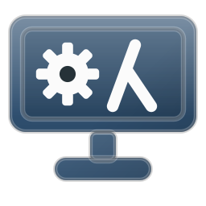

#+title: Heks GNU/Linux 🐂 🐧
#+subtitle: The witch's Void — a modular, programmable GNU/Linux desktop written in Guile Scheme
#+author: Josep Bigorra
#+email: jjbigorra@gmail.com
#+options: toc:1

[[https://jointhefreeworld.org/ggg/dist/scheme-guile.svg]]  [[https://jointhefreeworld.org/ggg/dist/maak.svg]]  [[https://jointhefreeworld.org/ggg/dist/license-mit.svg]]  [[https://jointhefreeworld.org/ggg/dist/gnu-guix.svg]]

[[https://github.com/jjba23/heks-linux][GitHub]] · [[https://codeberg.org/jjba23/heks-linux/issues][Issues]] · [[file:docs/index.org][The manual]] · [[https://jointhefreeworld.org/api-docs/heks-linux/index.html][API reference]] · [[https://bmc.link/jjbigorra][Buy me a coffee ☕]]

#+attr_html: :width 160 :alt Heks GNU/Linux logo

#+begin_quote
*A heks is a witch.* Not the kind that hides her work: the kind that writes it
down. Heks GNU/Linux is her grimoire — one small library of Guile Scheme
modules that renders every file a desktop actually reads, from Niri's tiling or LabWC's floating, to
the ink on the bar. No incantation you have to remember, no state you cannot
read back.

You change a parameter, the system is re-derived, and the same spell
gives the same desktop on the next machine.

It stands on *Void* and *Debian*. Heks as in the witch, as in the magical one, the one who can bend the digital world with Lisp. The
void is the ground she draws it on.
#+end_quote

** At a glance

| *Question*        | *Answer*                                                                   |
|-------------------+----------------------------------------------------------------------------|
| What is it?       | A modular dotfile and system-provisioning layer written in Guile Scheme.   |
| What is it not?   | A distribution, a desktop environment, or a package manager.               |
| What else is it?  | The image: a live Void ISO and an installable rootfs, built by the same modules, and a Debian live medium carrying the same desktop's packages. |
| Who is it for?    | Power users, developers, researchers, engineers, Emacs people, and tinkerers who want a system they can read, shape, and reproduce. |
| Official path     | Void Linux (runit, xbps) with Niri, Labwc and greetd, validated daily.     |
| Second target     | Debian 13 or newer (systemd, apt): the same desktop, the distribution's own package names. |
| Core stack        | GNU Guix, Guile Scheme, Maak, Niri, Labwc, whelk, Kitty, Lambdock, heks-toon. |
| License           | MIT for code, documentation, and every font configuration in the tree.     |

#+begin_quote
*Status:* Heks is used daily on Joe's machines — 1 laptop and 1 desktop. It is
stable enough to live in, and honest enough to tell you when a module is still
growing.
#+end_quote

All features are opt-in and modular. The modules render configuration files
rather than distribution state, so another distribution is a package backend
away, but Void is the one Joe runs daily and the one every instruction here is
written against.

The whole project is the picture below: settings go in, renderers turn them into
files, and the programs that read those files are the desktop. The loop back is
the part people miss — the same render that writes a file is what the tests, the
manifest and the audit inspect.

#+attr_html: :width 760 :alt Parameters become files, the files become the session, and the session is audited

[[file:docs/how-it-works.org][How Heks works]] takes the picture apart, step by step.

** Ten minutes to a desk

Heks provisions a session on a machine you already run. On Void with Guix
installed, the whole path is seven lines:

#+begin_src shell
git clone https://codeberg.org/jjba23/heks-linux.git
cd heks-linux
guix pull --channels=channels.scm          # the pin, not "latest"
guix install maak guile
maak install-xbps                          # what the distribution carries
maak xbps-build && maak install-collection # shell, dock, reference - from packages
maak home-reconfigure                      # render every file, start what is idle
#+end_src

On Debian the same seven lines carry two words: the package step is ~maak
install-apt~ and the programs step is ~maak deb-build~, and everything under
them - the channels, the shell, the dock, the render - is the file it is on
Void.  Debian spells a few names differently (~fd-find~ for ~fd~,
~libgl1-mesa-dri~ for the drivers, ~guile-3.0~, ~rustc~), and
[[file:docs/install-debian.org][the Debian page]] has the whole of it,
including what Debian does not carry at all.

Two of those things are the reason the Debian path has a page of its own:
Debian 13 packages neither Niri nor the X11 satellite its launcher needs, so
both are built from their own repositories, and Guix's installer stops at
=Missing commands: newgidmap= until ~sudo apt-get install uidmap~ has run.
Neither is a step on Void.  [[file:docs/install-debian.org][The Debian page]]
has the commands.

Nix appears nowhere in those lines, and that is the point: whelk, Lambdock and
heks-toon are packages this repository builds from the recipes under
~packaging/~, so a session that draws with them needs no store running.  Nix is
what the development tooling comes from, when you want it.

Log out, pick the Heks session from the prompt, log back in. Nothing else is
required: every surface that was written watches its own file and reloads
itself, which is the same path a running session takes when you edit one by
hand.

The other way in is the medium this project builds itself — a live Void ISO and
an installable rootfs carrying this desktop, with a guided installer that asks
a few questions:

#+begin_src shell
maak image                                 # both artefacts, into dist/image
#+end_src

There is a Debian medium as well, second class to the Void one: Debian's own
live-build and Debian's own installer, with this desktop's packages and
~heks-setup~ on the medium instead of a wizard or a finished desktop:

#+begin_src shell
maak image-debian                          # one ISO, into dist/image-debian
#+end_src

[[file:docs/installation.org][Installation]] has the long version of all three: the
requirements, the step-by-step install, full-disk encryption, and what to do when
the login refuses the password.

** What makes Heks different?

- *Reproducible by construction.* GNU Guix and pinned channels mean "works on
  my machine" is a starting point, not an excuse.
- *Modular by design.* Install the Niri config without the shell's config;
  install the music stack without either. Modules are opt-in and independently
  useful — there is no central registry to update and no daemon.
- *Programmable all the way down.* Parameters, modules, and the REPL are not an
  afterthought bolted onto static files. The system is Lisp, and a REPL into a
  running session is the debugging tool.
- *Emacs-native.* Kitty's Emacs-shaped key layer, the Emacs bridge, and the
  shell workflow all assume you live in Emacs and the terminal.
- *Beautiful by default.* A curated palette set drives the whole desktop, not
  just one application — and where a palette's legibility is a claim, the suite
  measures it: the bar's ink against its own material, Luna's black against its
  beige.
- *Tested with the real thing.* The unit suite renders whole configuration files
  and asserts on the text the real program will parse, the documentation
  included: a link to a page that moved fails the tests.
- *Portable where it costs nothing.* The modules render files, not distribution
  state: the package lists are data, and the session does not care which manager
  installed a program. Void is the path, Debian is the second target with a
  backend and a page of its own, and a third distribution is a module that
  implements the same four answers.
- *Yours to shape.* Per-machine overrides live outside Git and are read inside
  the module's own namespace, so you can change a machine without forking.

#+begin_quote
If you want a zero-config, click-through installer, Heks will feel too
opinionated. If you want a system you can shape with Lisp, welcome home.
#+end_quote

** Who is this for?

- Power users who want an opinionated, smooth and customizable Wayland desktop.
- Researchers and engineers who value reproducibility on their own device too.
- *Tinkerers who want to read and change every line.* Every module is small,
  documented, independently useful and loosely coupled.
- *People who want the same setup on their next machine.* The parameters live in
  Git and the machine's overrides outside it, so a fresh Void install is a
  clone, a pull and a reconfigure.
- *Anyone who thinks a desktop should feel like a well-kept workshop.*
- Developers and tech savvy people who live in the *terminal* or in *Emacs*.

** Core features

*** Desktop and session

- Wayland-first environment: Niri scrollable tiling compositor, whelk — the
  shell: bar, launcher, notifications, network and clipboard panels and the
  lock screen — Lambdock, Emacs PGTK, Kitty, and friends.
- Rounded windows, soft shadows, spring-driven animations, and optional blur.
- Clipboard history with a searchable picker: ~Mod+V~, or the clipboard glyph
  on the bar.
- Passwords on the bar: the key glyph opens the machine's password manager,
  started with the session and raised when it is already running. One setting
  (~heks-linux-password-command~) drives both the login line and the glyph, so
  the distribution's =1password= and the Flatpak are both one line away, and the
  bar can still be pointed at a manager of its own.
- Do-not-disturb mode for notifications, owned by the shell and bound to
  ~Mod+Shift+N~.
- The shell's own lock screen, bound to ~Mod+L~: the compositor holds the
  session lock, and PAM is what releases it. Swayidle remains for the idle
  timeout.
- Niri keybindings biased toward power users, with a hotkey cheatsheet overlay —
  and [[file:docs/keybindings.org][a page of the same table]], generated from the
  bindings the compositors are actually rendered from.

*** Capture: screenshots, GIFs, video

- One program, ~heks-capture~, with a verb per thing it takes: a screenshot of a
  region, a monitor or a window; a GIF at full size or cut down small enough for
  a chat window; a video the GPU encodes through ~wl-screenrec~.
- One capture menu on ~Mod+A~, and the bar's camera: what am I taking, and of
  how much.
- Windows are taken by the compositor and GIFs are encoded by ~gifski~; the
  annotator is whichever of ~satty~, ~swappy~ or GIMP the machine has.
- ~heks-capture doctor~ says which of the tools it drives are missing and which
  task installs them.
- [[file:docs/capture.org][The whole of it, verb by verb]].

*** Terminals and the Emacs connection

- Kitty is the main terminal, rendered from the same palette and font as the
  rest of the session.
- Kitty claims no bare Emacs chord, because a chord it claims never reaches
  Emacs or readline again. The terminal's commands live behind a modal prefix,
  =ctrl+shift+x=, shaped like Emacs's ~C-x~.
- Tabs and windows behave like Emacs buffers and windows: after =ctrl+shift+x=,
  ~t~ opens a tab, ~o~ moves to the other window, ~0~ closes it, and ~b~ moves to
  the next tab.
- Kitty's tab bar is hidden by default; ~tab-bar?~ in a profile brings it back.
- Bridges connect Heks Linux to Bash and Emacs, so fonts, theme, clone
  directory, notes directory, and shell highlight colours stay in sync.

*** Browser

- Zen Browser from Flathub, configured from Scheme: vertical tabs, uBlock
  Origin, tracking protection that leaves sites working, and the Browser
  Toolbox.
- ~maak install-zen~ renders ~user.js~ into every Zen profile it finds — the
  native ~.zen~ tree and the Flatpak sandbox alike — and side-loads the signed
  uBlock Origin build once.
- Zen's DevTools theme follows the active palette; the rest of the browser
  chrome stays Zen's own.

*** The launcher, the notifications and the dock

- The shell is whelk, and its launcher is one overlay with one fuzzy matcher:
  applications, windows, commands with completion, arithmetic, files, the web,
  SSH hosts and menus. Every mode has a prefix or a key — ~Mod+Space~ or
  ~Mod+/~ for applications, ~Mod+Tab~ for the window switcher — and the
  applications mode is the desktop's search, one click away three times over:
  the magnifier next to the clock, the search row of the shell menu, and
  ~Mod+Space~.
- The shell is also the notification daemon. Toasts arrive at the top right in
  the palette's own ink, a grouped centre keeps what they said, actions are
  buttons, and do-not-disturb is a switch rather than a mode in another
  program's config file. A critical notification waits to be dismissed. The
  shell draws its own material for every one of those surfaces, so the
  compositor adds no shadow or blur behind them.
- A keyboard reference, one page per application (Niri, Kitty, Emacs, whelk,
  the bar), opens from the ~?~ button on the bar: one GTK4 window with the
  walls and the palettes beside it, not a page in a browser.
- Lambdock is the Wayland-native GTK4 dock: auto-hide, window tracking,
  indicators, popovers, and a palette-derived theme. Its Kitty entry uses
  Kitty's own icon.

*** Theming and palettes

- A curated collection of gorgeous, modern, and accessible colour palettes —
  [[file:docs/palettes.org][every one of them listed here]].
- One palette symbol drives GTK, dconf, the shell, Kitty, Lambdock, btop, and
  the matching wallpaper set. Emacs receives the matching theme through the
  Emacs bridge.
- Change the palette from heks-toon with ~Mod+Shift+C~, from the bar's palette
  glyph, or from the picker that glyph opens on a right click: every palette is
  drawn as a card of its own four colours, and choosing one repaints the whole
  desktop, the bar, the notifications, the terminal and the running Emacs in
  about a second.
- Tela icons in the palette's accent colour and its light or dark brightness,
  and the Adwaita cursors that come with the toolkit, with sensible fallbacks
  for fonts.
- A wallpaper chooser that follows the palette: ~Mod+Shift+W~, or the picture
  glyph on the bar, opens the whole collection as one window with a large
  preview of whatever is selected, while ~Mod+Shift+B~ shuffles and ~Mod+L~
  locks over whatever is currently on screen. Rotation is whelk's — ninety
  minutes by default — so the desktop turns over while you are working instead
  of overnight.

*** Developer experience

- Guile Scheme all the way down: parameters, modules, REPL, and testable data
  structures.
- Per-machine overrides without forking: drop a file in
  ~$XDG_CONFIG_HOME/heks-linux/~.
- A task runner, Maak, with small composable tasks instead of one giant script —
  [[file:docs/commands.org][the whole deck is on one page]].
- GNU Guix manifest and pinned channels for reproducible development shells.
- Unit specs with Veritas and coverage reports. A render can be recorded instead
  of performed, which is what the specs, the surface manifest and ~maak audit~
  inspect — one render, three views of it.
- ~maak doctor~ says which reader program is missing and which surface no key
  reaches; ~maak audit~ diffs what the modules would write against what is on
  disk, read-only; ~maak describe~ prints the desktop as one JSON document.
- Git identities selected by directory with ~includeIf~.
- Podman container configuration for rootless development.
- Kotlin Language Server installation task for JetBrains users.
- Generated API documentation from module docstrings.

*** The whelk bar

- A bar shaped like a classic menu bar, not a floating capsule: flush with the
  top edge, the full width of the screen, 32 pixels tall, with the machine's own
  mark at the far left and the focused application's File, Edit and View beside
  it.
- The material under it is the wallpaper the compositor blurred, a veil tinted
  between the palette and a neutral grey, a lit top edge and a hairline at its
  foot - and there is no shadow, because a menu bar is the top of the screen.
- Everything read once in a while - the load, the keyboard reference, the
  wallpapers, the palettes, the characters, the keyboard layout, the brightness -
  waits behind a chevron, so the clock stays where a menu bar puts it.
- [[file:docs/bar.org][The bar, measured and argued through]].

*** Music and media

- Free music, as in freedom 🎵, with batteries included: PipeWire, MPD, RMPC and
  Cava, all from the distribution's packages.
- RMPC is driven with Emacs' keys where RMPC has the action, its theme follows
  the palette down to the volume slider, and Cava is its visualiser rather than
  a program beside it.
- Two hooks make it part of the desktop: a notification with the album art on
  every song change, and a radio stream that keeps playing across them.
- [[file:docs/media.org][Music and media, in full]].

*** Packages and system setup

- Package lists for both targets, curated rather than a pattern: the packages a
  session needs, in lists you can read and edit - xbps on Void, apt on Debian.
- The desktop's own programs - whelk, Lambdock, heks-toon - as **native
  packages**, built from the recipes under ~packaging/~: ~maak xbps-build~ or
  ~maak deb-build~, then ~maak install-collection~.  No store is needed for a
  session to start, and the machine's own manager upgrades them.
- An encrypted disk layout in the official instructions: LUKS2 with Argon2id,
  BTRFS subvolumes, and GRUB — plus daily snapshots and the commands to roll
  back to one. See
  [[file:docs/installation.org::#full-disk-encryption][Full disk encryption]].
- A declarative Flatpak catalog: id and remote per application, automatic
  Flathub bootstrap, per-machine extras, and update/garbage-collection tasks.
- Guix for reproducible tools and development environments; Nix for the
  development tooling the distributions do not carry - language servers,
  debuggers, and a shell to try a package in - and nothing the desktop draws
  with; Podman for containers and complex workflows.
- Update helpers for every package manager in the stack, and ~maak
  check-updates~, which asks all of them what would change and installs nothing.

*** The image

- The desktop as a live Void ISO and as an installable rootfs, described in
  Guile and built with void-mklive: the package list, the =config.sh= that runs
  in the chroot and the two build scripts are rendered from the same parameters
  the session reads, so the image and the desktop cannot disagree about a
  palette or a hostname.
- The medium carries the disk tools and a guided installer, ~heks-install~: ten
  questions, full-disk encryption, snapshots, and a system that boots into the
  desktop rather than into a session with a bar and nothing else.
- See [[file:docs/void-image.org][docs/void-image.org]].
- A Debian live medium as well, built by Debian's own live-build out of the apt
  backend's package list: Debian's installer, the same payload, and ~heks-setup~
  to install the stores and render the desktop afterwards.  It is second class
  to the Void image and says so - no wizard of this tree's, and no desktop baked
  into the medium - see [[file:docs/debian-image.org][docs/debian-image.org]].

*** Documentation and community

- This page as the front door, [[file:docs/index.org][a manual that maps the
  rest]], and [[file:HACKING.org][HACKING.org]] as the developer's tour.
- Per-module docstrings, unit tests (the documentation among them), and
  generated API documentation that CI builds and publishes on every push.
- A warm code of conduct and a human-in-the-loop AI policy.

** Documentation

The long-form documentation lives in [[file:docs/][docs/]]. This README stays the
front door: what Heks is, what it looks like and where to read next.
[[file:docs/index.org][The manual]] is the map — every page, grouped, with the
reading order for the three kinds of reader.

| Document | What it covers |
|----------|----------------|
| [[file:docs/index.org][The manual]] | The map: every page, what it answers, and where to start |
| [[file:docs/installation.org][Installation]] | Requirements, the ways in, the quick start, encryption, the live medium |
| [[file:docs/install-void.org][Installing on Void]] | The Void install by hand, step by step, with what to check after each |
| [[file:docs/install-debian.org][Installing on Debian]] | The same install in Debian's own words: apt, systemd, and what Debian does not carry |
| [[file:docs/commands.org][The command deck]] | Every Maak task, what it does and when to reach for it |
| [[file:docs/how-it-works.org][How Heks works]] | The renderer, the surfaces, the task graph and the write path |
| [[file:docs/configuration.org][Configuration and customization]] | Parameters, per-machine overrides, worked examples and font rendering |
| [[file:docs/palettes.org][Palettes]] | Every palette the collection ships |
| [[file:docs/users.org][Other users]] | Declaring the machine's accounts and rendering each home |
| [[file:docs/kitty.org][Kitty]] | The Emacs terminal, its keys and its modal command layer |
| [[file:docs/eca.org][Chatting with the agents]] | The chat Emacs runs, the two terminal clients and the two desktop windows onto the same accounts |
| [[file:docs/zen-browser.org][Zen Browser]] | Profiles, vertical tabs, hardening and uBlock Origin |
| [[file:docs/desktop.org][The desktop, piece by piece]] | Switching palettes at runtime and the wallpaper engine |
| [[file:docs/bar.org][The bar]] | The menu bar's shape, its material and the shelf behind the chevron |
| [[file:docs/capture.org][Screenshots, GIFs and video]] | One program, its verbs, and the tool behind each |
| [[file:docs/media.org][Music and media]] | MPD, RMPC and Cava; the theme, and the two hooks that make them part of the desktop |
| [[file:docs/keybindings.org][Keybindings]] | The default Niri bindings, generated from the tables |
| [[file:docs/surfaces.org][The surface manifest]] | Every surface, the files it writes, what reads them and the key that reaches it |
| [[file:docs/guides.org][Guides]] | Emacs, Flatpak, Nix, containers, browsers and the small things |
| [[file:docs/debian-image.org][The Debian medium]] | The second-class image: Debian's live-build, Debian's installer, heks-setup afterwards |
| [[file:docs/distrobox.org][Distrobox and .deb packages]] | A Debian box for .deb programs, with this session's audio and GPU |
| [[file:docs/philosophy.org][Philosophy]] | Why Guix, and the four ideas worth internalizing |
| [[file:docs/contributing.org][Contributing]] | Ways to contribute, the development quick start and review |
| [[file:docs/troubleshooting.org][When it does not work]] | The failures that actually happen, and the page that explains each one |

The pages that describe the distribution this tree is built for:
[[file:docs/void-image.org][the Void image]],
[[file:docs/how-it-works.org][how the pieces fit]] and
[[file:docs/about-ssh.org][SSH hosts and keys]].
[[file:HACKING.org][HACKING.org]] is the contributor's tour of the source layout.

*** How the surface table is built

~docs/surfaces.org~ is a view, not a list. The files a surface writes are
measured by rendering it into a scratch directory, the programs that read it
are declared by the surface itself, and the key that reaches it is found by
searching the niri and labwc binding tables. The docs, the doctor and
~heks-audit~ print those same rows, which is why they cannot disagree about
what a surface writes.

#+attr_html: :width 720 :alt The surface table built from renders, readers and compositor bindings
[[file:resources/diagrams/surface-table.svg]]

** Companion projects

Some more modules that are recommended if you like Heks GNU/Linux, adding
important functionality:

- [[https://codeberg.org/jjba23/heks-bash][heks-bash]] is my Bash shell
  configuration. It integrates nicely with Heks Linux.
- [[https://codeberg.org/jjba23/heks-emacs][heks-emacs]] is my Emacs
  configuration. It is a key member of Heks Linux too.
- [[https://github.com/jjba23/lambdock][lambdock]] is the dock I use,
  built by me ([[https://codeberg.org/jjba23][jjba23]]): hyper-hackable, smooth,
  high-performance, hot-reloading, Wayland-native GTK4 (C + Guile Scheme).

** Philosophy, in four lines

Everything in the codebase falls out of four ideas: configuration is a function
of settings; settings are parameter objects rather than arguments; every module
is independently useful; and a data structure beats a template string. When a
design decision here looks odd, it is almost always one of those four in
disguise.

[[file:docs/philosophy.org][docs/philosophy.org]] argues them, and
[[file:docs/how-it-works.org][docs/how-it-works.org]] shows what they compile
into — the write path, the overrides and the task graph.

*** On fonts

Heks names the faces it draws in and ships none of them. The interface face is
*Work Sans*, the terminal face is *JuliaMono* and the serif is *Source Serif 4*:
all three free software under the SIL Open Font License 1.1, and all three
packaged by the distributions this project targets (Void carries Source Serif 4
as =font-adobe-source-serif-pro=; JuliaMono and Work Sans have no Void package
and are installed by hand).
Nothing in this repository is a typeface, so the MIT license below covers
everything a clone of it contains. [[file:docs/configuration.org][Why these three
faces]] is where the choice is argued.

** Contributing

Heks is a personal system that grew a community, and there is room for you here.
You do not need to be a Guile expert to make a valuable contribution: a clear
bug report, a fixed typo in these pages, a new palette, or a better docstring all
count.

- *Try it and tell us what broke.* Include the command you ran and the generated
  file if it is relevant, and say which Void release you are on.
- *Improve the docs.* The README, the pages under ~docs/~, and
  [[file:HACKING.org][HACKING.org]] are all fair game.
- *Add a module* for a tool you use every day, or *add a palette* and make sure
  it looks good across GTK, the shell, Kitty, Lambdock, btop, and the wallpaper
  set.
- *Report bugs* at [[https://codeberg.org/jjba23/heks-linux/issues][the Codeberg
  issue tracker]], and *send a patch or pull request* that keeps the diff
  focused on one module or one feature.

Getting set up, the test runner's environment variables and what CI runs are on
[[file:docs/contributing.org][the contributing page]]; the repository map, the
conventions and how to add a module step by step are in
[[file:HACKING.org][HACKING.org]]. The short version, from a machine with Guix:

#+begin_src shell
guix shell -m manifest.scm          # guile, veritas, scriba, dokgen
maak validate                       # format, compile, test
#+end_src

~maak validate~ formats, compiles, and tests. If it is green, you are in good
shape. To iterate on one spec:

#+begin_src shell
guile -L ./src -L ./test -c '((@ (veritas unit whelk-spec) spec))'
#+end_src

CI runs ~maak ci~ and then ~maak deploy~ on every push to ~trunk~ through
Woodpecker/Byggsteg -- gates first, so a tree that fails its own checks is never
the tree the site serves -- and the published API reference tracks the
docstrings in ~src/~.

** AI policy

This project follows the [[https://jointhefreeworld.org/ai-policy/][jointhefreeworld AI policy]].
[[file:AI_POLICY.md][AI_POLICY.md]] holds the short version; the full policy is the link above.

** Code of conduct

This project adheres to the jointhefreeworld code of conduct. Find it here:

https://jointhefreeworld.org/blog/articles/personal/jointhefreeworld-code-of-conduct/index.html

In summary, we foster an inclusive, respectful, and cooperative environment for
all contributors and users of this free software project. Inspired by the ideals
of the GNU Project, we strive to uphold freedom, equality, and community as
guiding principles. We believe that collaboration in a community of mutual
respect is essential to creating excellent free software.

** License

Heks GNU/Linux is free software: you can redistribute it and/or modify it under
the terms of the MIT License.

The source code and the documentation are distributed under *MIT*; see
[[file:LICENSE][COPYING]] for the full text.

The repository carries no third-party assets either: every font it configures is
a package of your distribution, and every face it names is free software.

If you reuse a module in your own project, keep the license header and share
your improvements. That is how the commons grows.

** Support the project

If Heks saves you time, makes your desktop nicer, or teaches you something about
Guile, consider supporting the work:

[[https://bmc.link/jjbigorra][Buy me a cup of coffee ☕]]

Your support directly contributes to sustained focus and ongoing improvements.
You can also help by starring the repository, reporting bugs, improving the
docs, or sending a patch.

** Acknowledgements

Heks stands on the shoulders of giants. Thank you to GNU, GNU Guix, Guile,
Niri, whelk, Kitty, Lambdock, Maak, Veritas, Scriba, Documenta,
Emacs, MPD, RMPC, Cava, Tela icons, Adwaita, and the wider free software
community.

#+begin_quote
Built with care, a Lisp, and a lot of coffee. Welcome to the witch's system.
#+end_quote
