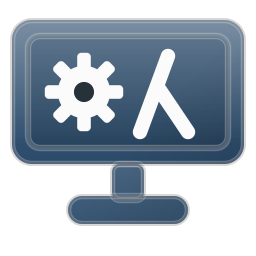

#+title: Heks GNU/Linux 🐂 🐧
#+subtitle: The witch's system — a modular, programmable GNU/Linux setup written in Guile Scheme
#+author: Josep Bigorra
#+email: jjbigorra@gmail.com
#+options: toc:1

[[https://jointhefreeworld.org/ggg/dist/scheme-guile.svg]]  [[https://jointhefreeworld.org/ggg/dist/maak.svg]]  [[https://jointhefreeworld.org/ggg/dist/license-mit.svg]]  [[https://jointhefreeworld.org/ggg/dist/gnu-guix.svg]]

[[https://codeberg.org/jjba23/heks-linux][Codeberg]] · [[https://codeberg.org/jjba23/heks-linux/issues][Issues]] · [[https://jointhefreeworld.org/api-docs/heks-linux/API.html][API reference]] · [[https://bmc.link/jjbigorra][Buy me a coffee ☕]]

#+attr_html: :width 160 :alt Heks GNU/Linux logo

#+begin_quote
*Heks* is Dutch for *witch*. Heks GNU/Linux is the witch's system: a modular,
programmable, reproducible GNU/Linux setup that treats your dotfiles as a small
library of Guile Scheme modules. Built on the shoulders of giants, it is a
reproducible whole that you can adapt, extend, and rebuild with confidence.
#+end_quote

** At a glance

| *Question*        | *Answer*                                                                   |
|-------------------+----------------------------------------------------------------------------|
| What is it?       | A modular dotfile and system-provisioning layer written in Guile Scheme.   |
| What is it not?   | A distribution, a desktop environment, or a package manager.               |
| What else is it?  | The image: a bootable Slowroll ISO and an installable disk image.          |
| Who is it for?    | Power users, developers, researchers, engineers, Emacs people, and tinkerers who want a system they can read, shape, and reproduce. |
| Official path     | openSUSE Tumbleweed-Slowroll with GNOME + Niri, validated daily.           |
| Core stack        | GNU Guix, Guile Scheme, Maak, Niri, Waybar, Rofi, Mako, WezTerm, Lambdock. |
| License           | MIT for code, documentation, and every font configuration in the tree.     |

#+begin_quote
*Status:* Heks is used daily on Joe's machines.
It is stable enough to live in, and honest enough to tell you when a module is still growing.
#+end_quote

Heks GNU/Linux is the witch's system: modular, flexible, and extensible
GNU/Linux setup designed for all kinds of users, and especially powerful for
power users, developers, researchers, and engineers.

The project is written mostly in Lisp (Guile Scheme) and uses
[[https://codeberg.org/jjba23/maak][Maak, the infinitely extensible command-runner]], as its automation system,
with the GNU Guix package manager and build system. Reproducibility and
developer experience are first-class concerns here, not afterthoughts.

All features of Heks GNU/Linux are opt-in and modular, and compatible with many
distributions. The officially maintained path is a system built on top of
openSUSE Tumbleweed-Slowroll (Niri + some GNOME parts): Joe's setup. Everything should work
on other GNU/Linux distributions that can run Guile, with some small changes, so
feel free to contribute modules, instructions, and tips specific to your distro.

If you like my work, please support me by
[[https://bmc.link/jjbigorra][buying me a cup of coffee ☕]] so I can continue with
a lot of motivation. Your support directly contributes to sustained focus and
ongoing improvements.

Find the complete technical Guile Scheme API documentation for Heks Linux here:
https://jointhefreeworld.org/api-docs/heks-linux/API.html

** Who is this for?

- *Power users who want a tiling Wayland desktop without assembling twenty
  unrelated repositories.* Niri, Waybar, Rofi, Mako, Lambdock, and WezTerm are
  rendered from one coherent set of settings.
- *Researchers and engineers who value reproducibility.* The whole environment
  is pinned through ~channels.scm~ and can be rebuilt with ~guix time-machine~.
- *Tinkerers who want to read and change every line.* Every module is small,
  documented, and independently useful.
- *Distro hoppers who want their setup to follow them.* The same parameters can
  render your session on openSUSE, Debian, Fedora, or anywhere Guile runs.
- *Anyone who thinks a desktop should feel like a well-kept workshop,* not a
  drawer full of mismatched config files.
- *Developers and tech savvy people who live in Emacs and the terminal.* Unified configuration with
  guarded Emacs keybindings; Emacs and Bash get first-class bridges.

#+begin_quote
If you want a zero-config, click-through installer, Heks will feel perhaps too opinionated.
If you want a system you can shape with Lisp, welcome home.
#+end_quote

** What makes Heks different?

- *Reproducible by construction.* GNU Guix and pinned channels mean "works on
  my machine" is a starting point, not an excuse.
- *Modular by design.* Install the Niri config without the Rofi config; install
  the Rofi config without the music stack. Modules are opt-in and independently
  useful.
- *Programmable all the way down.* Parameters, modules, and the REPL are not an
  afterthought bolted onto static files. The system is Lisp.
- *Emacs-native.* WezTerm's guarded keybindings, the Emacs bridge, and the
  shell workflow all assume you live in Emacs and the terminal.
- *Beautiful by default.* A curated palette set drives the whole desktop, not
  just one application.
- *Tested with the real thing.* The unit suite renders whole configuration
  files and asserts on the text the real program will parse.
- *Portable by intention.* openSUSE Tumbleweed-Slowroll is the official path,
  and the Debian and Fedora guides show the same modules on other systems.
- *Yours to shape.* Per-machine overrides live outside Git and are read inside
  the module's own namespace, so you can change a machine without forking.

** Gallery

Screenshots from Joe's daily driver. Click any image to open it full size.

#+caption: A full desktop view with the Niri session in modus-vivendi
[[https://jointhefreeworld.org/static-assets/heks/screen-2026-07-15-23-32-24.png]]

#+caption: The catppuccin palette in session
[[https://jointhefreeworld.org/static-assets/heks/screen-2025-12-27-00-46-50.png]]

#+caption: The recorded tour: a typed terminal, a palette arriving on it, heks-toon, the launcher, the dock's launchpad and the lock screen
[[https://github.com/jjba23/heks-linux/releases/download/v1.42.0/heks-demo.gif]]

** Core features of Heks GNU/Linux

*** Desktop and session

- Wayland-first environment: Niri scrollable tiling compositor, Waybar, Rofi,
  Mako, Lambdock, Emacs PGTK, WezTerm, and friends.
- Rounded windows, soft shadows, spring-driven animations, and optional blur.
- Clipboard history with ~clipman~ and a searchable Rofi switcher: ~Mod+V~, or
  the clipboard glyph on the bar.
- Passwords on the bar: the key glyph opens the machine's password manager,
  started with the session and raised when it is already running.  One setting
  (`heks-linux-password-command`) drives both the login line and the glyph, so
  the distribution's `1password` and the Flatpak are both one line away, and the
  bar can still be pointed at a manager of its own.
- Screenshots of a region, a monitor or a single window, saved and copied to
  the clipboard in one press, with optional annotation through ~satty~.
- GIF recording of a region or an output at two qualities: a full-size one for
  documentation, and a small palette-cut one for a chat window.
- Video recording through ~wl-screenrec~ (with ~wf-recorder~ as the fallback),
  so the GPU encodes and a recording costs a fraction of a core.
- Editing what was captured: a screenshot opens for annotation in ~satty~,
  ~swappy~ or GIMP (whichever is installed), and GIFs can be cut, sped up,
  cropped, resized, recoloured or reversed — from the command line or from a
  rofi menu bound to a key.
- One capture menu on ~Mod+A~ and the bar's camera: what am I taking
  (screenshot, GIF or video), and of how much (the whole screen, a region, or a
  window).  ~heks-capture doctor~ says which of the tools it drives are missing
  and which task installs them, so ~maak install-capture~ ends by telling you
  rather than by failing later.
- Do-not-disturb mode for notifications, surfaced on Waybar and bound to
  ~Mod+Shift+N~.
- Swaylock and Swayidle for the lockscreen and idle timeout.
- Niri keybindings biased toward power users, with a hotkey cheatsheet overlay.

*** Terminals and the Emacs connection

- WezTerm is the main terminal, rendered from the same palette and font as the
  rest of the session.
- WezTerm's Emacs keybindings are *guarded*: when Emacs, a pager, or another
  full-screen program owns the keyboard, the chord is handed back untouched.
- Tabs behave like Emacs buffers: ~C-x t~ opens, ~C-x o~ moves to the other tab,
  ~C-x 0~ closes, ~C-x b~ picks a tab by name.
- WezTerm's tab bar doubles as the window title bar under Niri.
- Bridges connect Heks Linux to Bash and Emacs, so fonts, theme, clone
  directory, notes directory, and shell highlight colours stay in sync.

*** Browser

- Zen Browser from Flathub, configured from Scheme: vertical tabs, uBlock
  Origin, tracking protection that leaves sites working, and the Browser
  Toolbox.
- ~maak install-zen~ renders ~user.js~ into every Zen profile it finds - the
  native ~.zen~ tree and the Flatpak sandbox alike - and side-loads the signed
  uBlock Origin build once.
- Zen's DevTools theme follows the active palette; the rest of the browser
  chrome stays Zen's own.

*** Launcher, notifications, and the dock

- Rofi provides six modes: applications (~drun~), a command line (~run~), the
  SSH hosts of ~/.ssh/config~ (~ssh~), the window switcher (~window~), the
  session/power menu (~power~), and the palette picker (~theme~).  Every mode is
  also a *button*: a row of pills sits under the search field, labelled with the
  mode's own name and with the one in use in the palette's accent, so switching
  what the field searches is a click rather than a keystroke nobody was told
  about.  The applications mode is the desktop's search, one click away three
  times over: the magnifier next to the clock, the Search row of the system
  menu, and ~Mod+Space~.  Every mode works with the mouse alone - the selection
  follows the pointer and a single click takes the entry, so nothing needs a
  Return - and the launcher's icons are 40 pixels so the grid can be scanned
  rather than read.
- Mako renders notification banners the way the reference drew them: a rounded panel
  in the palette's own ink over the wallpaper, a hairline rim instead of a frame,
  the title heavy and the body plain, and the application's icon at the left.
  The banner drops in *below* the menu bar rather than over it, and critical
  notifications wear the palette's accent in their rim and wait to be dismissed.
  A real do-not-disturb mode keeps the history without drawing anything.  There is
  no compositor shadow or blur behind a banner: mako's layer surface is sized for
  the whole stack of notifications rather than for the one on screen, so either
  effect is drawn around a rectangle nobody can see - a grey box above it, a dark
  one around it.  The rim is the banner's edge.
- A keyboard reference, one page per application (Niri, WezTerm, Emacs, Rofi,
  the bar), opens from the ~?~ button on the Waybar: one GTK4 window with the
  walls and the palettes beside it, not a page in a browser.
- Lambdock is the Wayland-native GTK4 dock: auto-hide, window tracking,
  indicators, popovers, and a palette-derived theme.
- The dock's WezTerm entry uses GNOME Terminal's icon for a familiar look.

*** Theming and palettes

- A curated collection of gorgeous, modern, and accessible colour palettes.
- One palette symbol drives GTK, dconf, Waybar, Mako, Rofi, WezTerm, Lambdock,
  btop, and the matching wallpaper set. Emacs receives the matching theme
  through the Emacs bridge.
- Change the palette from Rofi with ~Mod+Shift+C~, or click the palette glyph on
  the bar: every palette is drawn as a card of its own four colours, and
  choosing one repaints the whole desktop, the bar, the notifications, the
  terminal and the running Emacs in about a second.
- Tela icons in the palette's accent colour and its light or dark brightness,
  plus WhiteSur cursors, with sensible fallbacks for fonts.
- A wallpaper chooser that follows the palette: ~Mod+Shift+W~, or the picture
  glyph on the bar, opens the whole collection as one window with a large
  preview of whatever is selected, while ~Mod+Shift+B~ shuffles and ~Mod+L~
  locks over whatever is currently on screen. Rotation is a systemd timer that
  changes it every ninety minutes, so the desktop turns over while you are
  working instead of overnight.
- A bar shaped like a classic menu bar, not like a floating capsule: it is
  flush with the top edge and runs the full width of the screen, 32 pixels tall,
  in Work Sans at a regular weight - a little taller than the reference's own
  proportion, where 13 pixel text filled 59% of a 22 pixel bar, because this row
  also carries a mark and icons that are taller than its text.  At the far left, where the reference
  keeps its mark, it wears the machine's own: an empty star drawn as an outline,
  quiet at 16 pixels and readable in one ink - that mark opens one menu of what
  this machine is, how to make
  it yours and every way out of the session, with About This Heks on its first row
  and the same session rows the Rofi power menu offers.  Beside it is the focused
  window's title; everything else is a status item on the right, the magnifier
  where the reference keeps its search - next to the clock - with no chips and no
  dividers.  Under
  it all is the material the reference bar was made of: the wallpaper blurred and
  saturated by the compositor, a thin veil tinted halfway between the palette and
  the neutral grey, a lit top edge, a hairline at its foot, and the text
  shadowed so it stays readable over any wallpaper.  The shadow under the bar is
  off: a menu bar is the top of the screen, not a panel floating over it, and the
  hairline is the whole edge - the reference has nothing else, and on a light
  palette a shadow darkened the first fourteen pixels of every window by up to
  23%.  The windows the bar opens hang off its bottom edge instead of floating
  below it.
- Text is rendered the way the reference renders it: grayscale antialiasing, light
  hinting and no LCD filter, set once in ~fonts.conf~ so the bar, the launcher,
  the notifications, the terminal and the editor all smooth their glyphs the same
  way instead of only the surfaces GTK happens to own.  See
  [[file:docs/configuration.org][Font rendering]], and [[file:docs/configuration.org][Where the interface face comes from]]
  for where that face comes from.
- About This Heks is laid out like the reference's About dialog: the machine's name, the system
  it runs and who is logged in at the top, then Processor, Memory, Startup Disk,
  Kernel, Compositor, Palette and Uptime, one line each with the label in bold.

*** Developer experience

- Guile Scheme all the way down: parameters, modules, REPL, and testable data
  structures.
- Per-machine overrides without forking: drop a file in
  ~$XDG_CONFIG_HOME/heks-linux/~.
- A task runner, Maak, with small composable tasks instead of one giant script.
- GNU Guix manifest and pinned channels for reproducible development shells.
- Unit specs with Veritas and coverage reports.
- Git identities selected by directory with ~includeIf~.
- Podman container configuration for rootless development.
- Kotlin Language Server installation task for JetBrains users.
- Generated API documentation from module docstrings.

*** Music and media

- Free music, as in freedom 🎵, with batteries included: PipeWire, MPD,
  Euphonica, Cava, and RMPC.
- RMPC is driven with Emacs' keys where rmpc has the action, and its theme
  follows the palette down to the volume slider.
- RMPC is configured with search, artists, tabs, Cava visualisation, and the
  active palette.

*** Packages and system setup

- Zypper package lists for openSUSE.
- An image: the desktop as a live Slowroll ISO and as an installable disk image,
  described in Guile and built with KIWI.  See
  [[file:docs/slowroll-image.org][docs/slowroll-image.org]].
- A declarative Flatpak catalog: id and remote per application, automatic
  Flathub bootstrap, per-machine extras, and update/garbage-collection tasks.
- Guix for reproducible tools and development environments.
- Nix for extra packages and development shells.
- Podman for containers and complex workflows.
- Update helpers for every package manager in the stack.

*** Documentation and community

- A long-form developer guide in [[file:HACKING.org][HACKING.org]].
- Per-module docstrings, unit tests, and generated API documentation.
- Distribution-specific guides for openSUSE, Debian, and Fedora.
- A warm code of conduct and a human-in-the-loop AI policy.

** Documentation

The long-form documentation lives in [[file:docs/][docs/]].  This README stays
the front door: what Heks is, what it looks like and where to read next.

| Document | What it covers |
|----------|----------------|
| [[file:docs/installation.org][Installation]] | Requirements, the quick start and the step-by-step install |
| [[file:docs/commands.org][The command deck]] | Every Maak task, what it does and when to reach for it |
| [[file:docs/how-it-works.org][How Heks works]] | The renderer, the surfaces and the task graph |
| [[file:docs/configuration.org][Configuration and customization]] | Parameters, per-machine overrides, worked examples and font rendering |
| [[file:docs/palettes.org][Palettes]] | Every palette the collection ships |
| [[file:docs/wezterm.org][WezTerm]] | The Emacs terminal, its keys and its title bar |
| [[file:docs/zen-browser.org][Zen Browser]] | Profiles, vertical tabs, hardening and uBlock Origin |
| [[file:docs/desktop.org][The desktop, piece by piece]] | Switching palettes at runtime and the wallpaper engine |
| [[file:docs/keybindings.org][Keybindings]] | The default Niri bindings |
| [[file:docs/guides.org][Platform guides]] | The openSUSE Slowroll path, Debian, Fedora, Flatpak, Nix and the small things |
| [[file:docs/philosophy.org][Philosophy]] | Why Guix, and the four ideas worth internalizing |
| [[file:docs/contributing.org][Contributing]] | Ways to contribute, the development quick start and review |

Platform guides already in the tree:
[[file:docs/debian-guide.org][Debian]], [[file:docs/fedora-guide.org][Fedora]],
[[file:docs/slowroll-image.org][the Slowroll image]] and
[[file:docs/about-ssh.org][SSH hosts and keys]].
[[file:HACKING.org][HACKING.org]] is the contributor's tour of the source layout.

** Companion projects

Some more modules that are recommended if you like Heks GNU/Linux, adding
important functionality:

- [[https://codeberg.org/jjba23/heks-bash][heks-bash]] is my Bash shell
  configuration. It integrates nicely with Heks Linux.
- [[https://codeberg.org/jjba23/heks-emacs][heks-emacs]] is my Emacs
  configuration. It is a key member of Heks Linux too.
- [[https://github.com/jjba23/lambdock][lambdock]] is the dock I use,
  built by me ([[https://codeberg.org/jjba23][jjba23]]): hyper-hackable, smooth,
  high-performance, hot-reloading, Wayland-native GTK4 (C + Guile Scheme).

** Philosophy: reproducibility, modularity, and taste

*** Why GNU Guix?

A build should never fail because "it worked on my machine." Reliable software
development requires explicit, bit-for-bit reproducibility and a functional
approach to package management and system deployment.

#+BEGIN_EXPORT html

#+END_EXPORT

- *Declarative build graphs:* packages are pure functions of their inputs, with
  no implicit system state.
- *Programmable with Guile:* full system and package configurations written in
  [[https://www.gnu.org/software/guile/][Guile Scheme]] rather than rigid DSLs or
  static files.
- *Time travel:* rebuild the exact system state from any point in Git history
  using ~guix time-machine~.
- *Atomic operations:* instantly upgrade or roll back environments without
  leaving orphaned dependencies or broken states.
- *Unified tooling:* one tool manages development shells, isolated containers,
  package builds, and full system configurations.

*** The four ideas worth internalizing

Everything in the codebase falls out of four ideas. When a design decision looks
odd, it is almost always one of these four in disguise.

1. *Configuration is a function of settings.* Nothing about your machine is
   hardcoded in the logic. A module reads parameters and returns data
   structures; the same code produces a different system for you, on your
   laptop, with your fonts.
2. *Settings are parameter objects, not arguments.* This is what makes
   per-machine overrides, per-run overrides, and REPL-driven hacking possible
   without threading keyword arguments through twenty call frames.
3. *Every module is independently useful.* You can call ~install-rofi-config~
   without owning the rest of the project. There is no central registry that
   must be updated, no global mutable state, no daemon. Modules are opt-in.
4. *Prefer a data structure over a template string.* Waybar's config is a Scheme
   list serialized to JSON. Niri's config is a tree of records serialized to
   KDL. WezTerm's config is an association list rendered to Lua. This is why the
   modules can be unit-tested at all.

*** On fonts

Heks names the faces it draws in and ships none of them.  The interface face is
*Work Sans*, the terminal face is *JuliaMono* and the serif is *Source Serif 4*:
all three free software under the SIL Open Font License 1.1, and all three
packaged by the distributions this project targets (openSUSE:
=google-worksans-fonts=, =texlive-juliamono-fonts=, =adobe-sourceserif4-fonts=).
Nothing in this repository is a typeface, so the MIT license above covers
everything a clone of it contains.  [[file:docs/configuration.org][Why these three faces]] is
where the choice is argued.

** Contributing

Heks is a personal system that grew a community, and there is room for you here.
You do not need to be a Guile expert to make a valuable contribution: a clear
bug report, a fixed typo in a distro guide, a new palette, or a better
docstring all count.

*** Ways to contribute

- *Try it and tell us what broke.* Include your distribution, the command you
  ran, and the generated file if it is relevant.
- *Improve the docs.* The Debian and Fedora guides, the README, and
  [[file:HACKING.org][HACKING.org]] are all fair game.
- *Add a module* for a tool you use every day.
- *Add a palette* and make sure it looks good across GTK, Waybar, Mako, Rofi,
  WezTerm, Lambdock, btop, and the wallpaper set.
- *Add a distro guide* for the distribution you actually run.
- *Report bugs* at [[https://codeberg.org/jjba23/heks-linux/issues][the Codeberg issue tracker]].
- *Send a patch or pull request* that keeps the diff focused on one module or
  one feature.

*** Development quick start

The repository is self-contained: everything needed to build, test, and
document is in ~manifest.scm~.

#+begin_src shell
# 1. clone
git clone https://codeberg.org/jjba23/heks-linux.git
cd heks-linux

# 2. load the pinned channel set (this is the lock file)
guix pull --channels=channels.scm
hash guix
sudo systemctl restart guix-daemon

# 3. the task runner and Guile
guix install maak guile

# 4. enter the project environment
guix shell -m manifest.scm
#+end_src

Inside that shell you have ~guile~, ~guile-veritas~, ~guile-scriba~,
~guile-documenta~, and their dependencies, so ~guile -L ./src~ sees the source
tree with no extra setup.

If you prefer not to leave a shell open, note that every Maak task already wraps
itself in the manifest through ~time-machine-manifest-shell~, so
~maak compile~ just works from the repository root.

*** Before you open a pull request

#+begin_src shell
maak validate
#+end_src

~maak validate~ formats, compiles, and tests. If it is green, you are in good
shape. To iterate on one spec:

#+begin_src shell
guile -L ./src -L ./test -c '((@ (veritas unit rofi-spec) spec))'
#+end_src

The runner understands a few environment variables:

| *Variable*              | *Meaning*                                             |
|-------------------------+-------------------------------------------------------|
| ~VERITAS_ONLY_SUITE~      | Only run suites whose name contains this substring.   |
| ~VERITAS_ONLY_TEST~       | Only run tests whose name contains this substring.    |
| ~VERITAS_TEST_TYPE~       | Test directory to scan (default ~unit~).              |
| ~VERITAS_REPORTER~        | Reporter to use (CI passes ~monotone-reporter~).      |
| ~VERITAS_RUN_BENCHMARKS~  | Set to ~false~ to skip benchmark blocks.              |

CI runs ~maak test~ and ~maak deploy~ on every push to ~trunk~ through
Woodpecker/Byggsteg, so the published API reference tracks the docstrings in
~src/~.

*** Where to read more

[[file:HACKING.org][HACKING.org]] is the developer onboarding guide. It covers the project's
philosophy, repository map, development environment, build and test workflow,
how to add a module or palette step by step, coding and docstring conventions,
debugging tricks, and how to submit a contribution.

** AI policy

This project adheres to the
[[https://jointhefreeworld.org/blog/articles/personal/jointhefreeworld-ai-policy/index.html][jointhefreeworld AI policy]].

Our core principle is simple: *AI should assist human creativity and
problem-solving, never replace human reasoning.*

While tools like Large Language Models (LLMs) and interactive chatbots can be
beneficial for reviewing, refactoring small functions, or acting as a sounding
board, they should be used with moderation.

We require a human in the loop for all contributions.

** Code of conduct

This project adheres to the jointhefreeworld code of conduct. Find it here:

https://jointhefreeworld.org/blog/articles/personal/jointhefreeworld-code-of-conduct/index.html

In summary, we foster an inclusive, respectful, and cooperative environment for
all contributors and users of this free software project. Inspired by the ideals
of the GNU Project, we strive to uphold freedom, equality, and community as
guiding principles. We believe that collaboration in a community of mutual
respect is essential to creating excellent free software.

** License

Heks GNU/Linux is free software: you can redistribute it and/or modify it under
the terms of the MIT License.

The source code and the documentation are distributed under *MIT*; see
[[file:LICENSE][COPYING]] for the full text.

The repository carries no third-party assets either: every font it configures is
a package of your distribution, and every face it names is free software.

If you reuse a module in your own project, keep the license header and share
your improvements. That is how the commons grows.

** Support the project

If Heks saves you time, makes your desktop nicer, or teaches you something about
Guile, consider supporting the work:

[[https://bmc.link/jjbigorra][Buy me a cup of coffee ☕]]

Your support directly contributes to sustained focus and ongoing improvements.
You can also help by starring the repository, reporting bugs, improving the
docs, or sending a patch.

** Acknowledgements

Heks stands on the shoulders of giants. Thank you to GNU, GNU Guix, Guile,
Niri, Waybar, Rofi, Mako, WezTerm, Lambdock, Maak, Veritas, Scriba, Documenta,
Emacs, MPD, RMPC, Cava, Tela icons, WhiteSur, and the wider free software
community.

#+begin_quote
Built with care, a Lisp, and a lot of coffee. Welcome to the witch's system.
#+end_quote
