#+title: How Heks works
#+options: toc:nil

[[file:../README.org][← Back to the README]]

* How Heks works

At heart, this project is a Lisp (Guile Scheme) system that you can customize to
your liking, in a modular way. Each module is a small, readable bridge between
your settings and a real configuration file.

#+begin_example
        parameters            renderers                 files
  ┌────────────────────┐   ┌───────────────────┐   ┌──────────────────────────┐
  │ user-settings.scm  │──▶│  niri.scm         │──▶│ ~/.config/niri/config.kdl│
  │ ~/.config/heks-    │   │  whelk.scm        │   │ ~/.config/whelk/…        │
  │   linux/*.scm      │   │  palette-picker…  │   │ ~/.local/bin/…           │
  │ palette.scm        │   │  lambdock.scm …   │   │ ~/.config/lambdock/…     │
  └────────────────────┘   └───────────────────┘   └──────────────────────────┘
            ▲                        ▲                        ▲
            │                        │                        │
            └─────────  maak.scm (tasks)  ────────────────────┘
                    maak home-reconfigure / maak install-theme
#+end_example

Every module follows the same three-step shape:

1. read settings from Guile *parameter objects*,
2. render a *configuration file* for some piece of software,
3. write that file to its conventional location.

Everything else — the palettes, the keybindings, the notifications, the
launcher — is a consequence of those three steps. The palette-driven side
effects are the same pipeline with a different trigger: colours, GTK themes,
icon themes, dock theme, terminal colours and wallpapers all come from the one
palette symbol you picked.

** The write path

Step three is the same procedure everywhere, ~install-config-file!~ in
~src/heks-linux/prelude.scm~, and it is worth knowing because five of its
promises are what the rest of the tree relies on.

*It is atomic.* The content goes to a temporary file created beside the real
target with ~mkstemp!~ — the name is taken, not invented, so two renders of one
target cannot collide — and the target is replaced with a ~rename~. A reader
either sees the old file or the new one; it never sees half a file. That matters
most in exactly the case this project generates: a compositor that reloads when
its config changes will otherwise eventually reload a half-written one.

*It writes through a symlink.* A dotfile that is a link into a repository stays
a link: the write lands on what it points at, which is what writing through a
symlink always did. Chained links are followed for up to eight hops, and the
target is resolved *before* the temporary file is named, because a rename is only
atomic inside one directory.

*The permissions are set before the rename.* ~mkstemp!~ makes the file =#o600~;
the mode the surface asks for is applied to the temporary file, so the real name
never exists with the wrong one — which for a file like =~/.local/bin/heks-capture=
is the difference between a program and a document.

*A render can be recorded instead of performed.* With ~HEKS_RENDER_DIR~ set, no
promise above happens: every write is recorded into that directory as a numbered
file plus a ~manifest.tsv~ line of path, mode and content. That is the mechanism
behind three things on this page — the spec suite, the surface manifest and
~maak audit~ — and it is why they can inspect a whole render without touching
your home directory.

#+attr_html: :width 700 :alt A parameter is rendered to text, checked by the target's own reader, written atomically, and then read back by the surface

*The target's own reader is asked first.* Before anything is written, the
contents are handed to whatever the file's format says should judge them:
~niri validate --config~ for a KDL file, ~whelk --config~ for whelk's
~settings.scm~, ~xmllint --noout~ for XML, ~bash -n~ for a generated script, and
a plain read for Scheme and JSON. A file that fails is refused — the old file
stays, the task fails, and the session that would have read it keeps working —
instead of being written and discovered on the next login. A validator that is
not installed skips its check rather than failing it, so a machine with part of
the stack still renders the rest.

** Overrides: a profile is data, an override is code

~load-local-overrides~ is what a module calls to make itself per-machine, and it
reads at most one file: =$XDG_CONFIG_HOME/heks-linux/<profile-name>.scm=, or
=~/.config/heks-linux/<profile-name>.scm= when the variable is unset or empty.
The file is evaluated inside the module's own namespace rather than in a scratch
one, which is the whole trick:

#+begin_src scheme
(save-module-excursion
 (lambda ()
   (set-current-module (resolve-module '(heks-linux whelk)))
   (load local-file)))
#+end_src

Because the file runs *in* ~(heks-linux whelk)~, it can call the module's own
parameters by name — ~(whelk-bar-height 38)~ — with no imports, no registry and
no keyword arguments threaded through twenty call frames. The cost is worth
stating plainly: an override is a *program*, not a document, so nothing checks it
before it runs. A profile, by contrast, is data, and is applied *first*; the
override file is loaded after it, so the more specific machine wins.

What that looks like in practice, and every parameter a machine can set, is
[[file:configuration.org][Configuration and customization]].

** The settings / overrides / task triple

Every module named ~foo.scm~ participates in a naming convention that you must
follow, because the convention *is* the extension mechanism:

| Thing                 | Where it lives                               | Example                               |
|-----------------------+----------------------------------------------+---------------------------------------|
| The module            | ~src/heks-linux/foo.scm~                      | ~src/heks-linux/whelk.scm~             |
| Its installer         | an exported ~install-foo-config~ procedure    | ~install-whelk-config~                 |
| Its Maak task         | ~maak.scm~                                    | ~maak install-whelk~                   |
| Its settings module   | a parameter below it                          | ~whelk-bar-height~                     |
| Its local overrides   | ~$XDG_CONFIG_HOME/heks-linux/foo-settings.scm~ | ~whelk-settings.scm~                   |

The last row is the important one, and it is the same loader described above.
A user can change a machine without forking the project.

** The task graph

~maak home-reconfigure~ is not a script that runs twelve installers. It is a
split of the surfaces into two lists, and the split is the interesting part.

#+begin_example
;;; The surfaces whose contents embed palette colours.
(define theme-surfaces ...)
;;; The files a home reconfigure writes that a palette does not touch.
(define home-surfaces ...)
#+end_example

(the lists are the pair tables in ~maak.scm~, abridged here so that the split is
what you read.)

A reconfigure renders both lists; a palette switch renders only
~theme-surfaces~, which is what makes a switch cheap enough to bind to a key.
Both go through ~render-configs~, which does the GTK pass *first*, applies the
dconf keys, and only then rewrites the surfaces that reload themselves. The order
is not cosmetic: GTK is where the icon theme comes from, and a running surface
rebuilds itself when its own file is rewritten — the dock re-resolves every
launcher icon about 150ms after its settings file changes. Rewriting everything
in one pass applied the dconf keys seconds later, so the dock rebuilt its
launchers from the icon theme of the palette being *left* and kept them until the
next switch. Writing GTK first is what makes the icons follow the palette.

#+attr_html: :width 620 :alt A palette switch: GTK, then dconf, then the surfaces that reload themselves

Two more properties of the graph are load-bearing:

- *One Guile process per group, not one per file.* Entering the pinned manifest
  shell once for thirteen files is what makes a palette switch feel like a click;
  entering it thirteen times is what made it feel like a build.
- *Nothing is signalled afterwards.* There used to be a ~reload-surfaces~ step
  that poked the bar and restarted it when it had died. It is gone rather than
  emptied: Niri reloads when its KDL is written, whelk rebuilds its bar a quarter
  of a second after ~settings.scm~ changes, and the dock rebuilds its launchers
  the same way. A render writes and forgets, and every surface watches its own
  file — the same path a running session takes when you edit one by hand.

[[file:commands.org][The command deck]] lists every task; ~maak surfaces~ prints the graph as data.

** Four views of one render

Nothing in this tree keeps a hand-maintained list of what it writes, because a
hand-maintained list is a list that drifts. Three views are built from the
modules instead, and a fourth from the settings behind them:

| View | Built by | What it answers |
|------+----------+-----------------|
| [[file:surfaces.org][The surface manifest]] | rendering each surface into a scratch directory, plus the readers the surface declares and the key found in the binding tables | what a surface writes, what reads it, and what key reaches it |
| ~heks-surfaces --doctor~ (behind ~maak doctor~) | the same manifest against this machine's ~PATH~ | which reader program is missing, and which surface no key reaches |
| ~maak audit~ | the same render, diffed against the live tree | what would change, what already differs, what a module no longer writes |

They agree because they are the same rows. ~maak describe~ is the fourth: the
resolved settings of the machine as one JSON document, so the About window, a
bug report and a screenshot caption read the same values instead of re-deriving
them.

** What keeps it honest

- *Every module is independently useful.* ~install-whelk-config~ does not know
  that Niri exists. There is no central registry to update, no global mutable
  state and no daemon — which is also why nothing in the tree knows the complete
  set of surfaces a palette reaches, and why the manifest is generated.
- *A spec renders the whole file.* The unit suite does not assert on a
  serializer's opinion; it renders the configuration and asserts on the text the
  real program will parse, including the contrast of the bar's ink against its
  own material. A surface that renders something the target program rejects is a
  failing spec rather than a black screen.
- *The documentation is tested too.* The manual is a directory of Org pages, and
  a link to a page that moved is a failing test rather than a dead end:
  [[file:index.org][the manual]] explains the checks, and ~maak test~ runs them.

The long-form argument for these choices — and the ones this page has not needed
to name — is in [[file:philosophy.org][Philosophy]]. The tour of the source layout,
and how to add a module of your own, is in [[file:../HACKING.org][HACKING.org]].
