#+title: Installation
#+options: toc:nil

[[file:../README.org][← Back to the README]]

* Requirements

Heks does not need an installer: you install your GNU/Linux distribution first,
then Heks provisions your user session.  If you would rather not install one
first, it can build the distribution's image around itself - a live Void ISO
and an installable rootfs, both carrying this desktop - and that ISO carries a
guided installer, ~heks-install~, which puts the same system on a disk in ten
questions ([[#installing-from-the-medium][Installing from the live medium]]).
That path is [[file:void-image.org][docs/void-image.org]] and the ~maak image~ task.

Both ways in end in the same place — every file rendered on the machine that
will keep it — which is why the two paths share their last step and everything
above the requirements.

#+attr_html: :width 720 :alt Two ways in: provision a machine that has a distribution, or build and install the medium

| *Requirement*              | *Why you need it*                                              | *How to get it*                                      |
|----------------------------+----------------------------------------------------------------+------------------------------------------------------|
| A GNU/Linux distribution   | Heks configures a running system; it is not a distro.          | Void Linux, glibc, is the official target.            |
| Guile 3.0                  | The configuration language and runtime.                        | ~guix install guile~ or your package manager.         |
| GNU Guix                   | Reproducible environments and pinned channels.                 | [[https://guix.gnu.org/][guix.gnu.org]]                                       |
| Maak                       | The task runner that drives every install.                     | ~guix install maak~                                   |
| Niri and Kitty             | The core Wayland session Heks targets.                         | ~maak install-xbps~ on Void, or your package manager. |
| whelk                      | The shell: bar, launcher, notifications, network and clipboard panels, lock screen. | ~maak install-nix-packages~ (no distribution packages it); [[https://github.com/jjba23/whelk][its project page]] otherwise. |
| Lambdock                   | The application dock.                                          | ~maak install-lambdock~ (from the pinned flake; no distribution packages it). |
| Fonts and icons            | The intended look: JuliaMono, Work Sans, Source Serif 4, Tela icons. | ~maak install-xbps~ for the fonts Void carries (Source Serif 4 is =font-adobe-source-serif-pro=), ~maak install-icon-files~ for the icons; JuliaMono and Work Sans have no Void package and are installed by hand. |
| heks-toon                  | The keyboard reference, the wall chooser and the palette chooser, one GTK4 window. | ~maak install-heks-toon~. |
| Optional: Emacs 30 PGTK    | The full Emacs-integrated experience.                          | Build from source or use your distro package.         |
| Optional: Flatpak, Podman, Nix | Extra applications and development workflows.              | See the sections below.                               |

#+begin_quote
*Tip:* Void Linux with runit and xbps is the path, and the only one this tree
validates: Niri, the greetd login prompt, and ~maak install-xbps~ for everything
the distribution carries.  [[file:void-image.org][docs/void-image.org]] covers the
exception: building the Void image *around* these modules, so there is nothing to
install on top of.
#+end_quote

* Installing from the live medium
:PROPERTIES:
:CUSTOM_ID: installing-from-the-medium
:END:

The medium this project builds carries its own installed system and one command
that puts it on a disk: ~heks-install~.  It is a wizard, not a script you edit:
it asks ten things, every one of them a thing it cannot know, and defaults the
rest.  Every screen's title counts them, so the wizard says how far along it is
before you ask.

#+attr_html: :width 640 :alt The installer's screens, then the eight phases it runs after the confirmation

It is already on the screen when the medium finishes booting - the console *is*
the installer - so the first screen after the kernel is the welcome.  If you are
on a shell instead, or you cancelled and want it back:

#+begin_src shell
  sudo heks-install
#+end_src

| *Question*        | *Default*                    | *Why it is asked*                                   |
|-------------------+------------------------------+-----------------------------------------------------|
| The disk          | none - you pick from a menu  | Every disk attached is offered with what the machine reports about it - its size, how it is attached, its model, its partition table and the filesystems it already holds - so a disk is picked by what it is and not by its letter.  The one this medium runs from is refused and logged. |
| The firmware      | detected from /sys/firmware/efi | UEFI first, MBR second.  This is the layout, not a preference: it decides the partition table and the boot loader. |
| The network       | the one already up, if any   | Asked only when the machine is not already online: the interfaces NetworkManager sees, and a wireless network's name and password.  The connection is copied into the new system. |
| The passphrase    | none - typed twice, 8+ chars | It is asked once at boot, by the initramfs.          |
| The timezone      | =heks-linux-timezone=        | The clock is that name, and it is checked against =/usr/share/zoneinfo= before it is taken: a typo here is a wrong hour on every file the machine writes. |
| The locale        | =heks-linux-language=        | The language the system speaks, as a locale name (=nl_NL=, =en_US=): it is written to =/etc/locale.conf= as =LANG=, with =.UTF-8= after it. |
| The keyboard      | =heks-linux-keyboard-layout= | The console's layout, checked against =/usr/share/kbd/keymaps= and written as =KEYMAP= in =/etc/rc.conf=, which is where Void reads it.  The session's own layout comes from the same answer. |
| The hostname      | =heks-linux=                 |                                                     |
| The user          | =heks=                       | The account the desktop was rendered into; it is renamed, not replaced. |
| The user's password | none - typed twice         | It is in =wheel=, so it can administer the machine. |

Then it shows what it is about to do and asks once more.  Nothing is written
before that answer, and the disk is only touched after its name is typed out:
one menu entry is one keystroke away from the wrong disk.  The confirmation and
the summary name the disk the way the menu did - size, bus, model, table and
contents - because that is the screen where noticing that this is the wrong disk
still costs nothing.

Two answers are checked against the machine rather than taken on trust.  A disk
smaller than 8 GiB cannot hold the layout, so the menu says so and asks again
instead of failing an hour later; a machine with less than 4 GiB of memory gets a
cheaper passphrase KDF (512 MiB instead of a gibibyte), because Argon2id that
cannot allocate its memory in the initramfs is a machine that does not boot.

#+begin_quote
*The passphrase is typed on a US keyboard at boot.*  The initramfs asks before
any keymap is loaded, so a passphrase entered on a French or German layout here
cannot be typed at the prompt there.  Use letters and digits you can find blind,
and keep a copy somewhere that is not this disk.
#+end_quote

#+begin_quote
*The passphrase is asked on the console.*  The image carries a plymouth theme
that draws the name on a dark screen and asks for the disk passphrase in words -
"Enter your disk passphrase, then press Enter" - rather than printing the device
path the initramfs hands it, but the kernel command line the installer writes
turns the daemon off: a splash that cannot draw - a virtual machine, graphics
plymouth has no driver for - is a black screen with the box on it, and a
passphrase typed into a screen that shows nothing is a boot that looks broken.
The console asks the same question and always arrives.  Add =splash= to the
kernel command line in =/etc/default/grub= and run =grub-mkconfig= to have the
theme instead.
#+end_quote

#+begin_quote
*Installing with no network works.*  Three things need the network and nothing
else does: the desktop's own stores (guix and nix, a few gigabytes, installed on
the machine instead of shipped in the medium), the extras you leave on, and the
upgrade of the new system at the end.  The partitioner, the encryption, the
unpacking, the boot loader and the resolver do not - the new system is given a
resolver whether or not the medium ever had one, because a machine with no DHCP
has no =/etc/resolv.conf= to copy.  The summary says so before anything is
written, each of the three is skipped rather than attempted, and the installed
machine finishes the job with =sudo heks-setup USER= once it is online.
#+end_quote

#+begin_quote
*Void's non-free repository is enabled on the installed system.*  The medium
installs =void-repo-nonfree=, which is what puts the repository in
=/etc/xbps.d=, so the CPU microcode, the firmware a wireless card needs and the
drivers main does not carry are one =xbps-install= away.  A repository is not a
package: enabling it installs nothing by itself.
#+end_quote

** What it does

1. *Erases and partitions the disk.*  UEFI gets GPT, a 1 GiB EFI System
   Partition on =/boot/efi= and a 1 GiB =ext4= =/boot=; MBR gets a DOS label
   with the boot flag on the first partition and no ESP.  The rest of the disk
   becomes a LUKS2 container with BTRFS inside it, and three subvolumes -
   =@=, =@home= and =@snapshots= - are created in it.
2. *Mounts it.*  The root subvolume on the target, the boot partition under it,
   the ESP inside that on UEFI, and the home and snapshots subvolumes where
   their mountpoints go.
3. *Unpacks the installed system* the medium carries, and writes =/etc/fstab=,
   the kernel command line and =/etc/dracut.conf.d/10-crypt.conf= for the disk
   it found.  The hostname, the clock, the language and the keyboard are
   written here too - the payload arrives with the values the image was built
   with, and these are the answers you gave: =/etc/localtime= is a link into
   =/usr/share/zoneinfo=, =/etc/locale.conf= is one =LANG= line, and
   =/etc/rc.conf= carries =KEYMAP=, which is where Void's runit stages read the
   console's layout.
4. *Installs and configures the boot loader* for the firmware it was told
   about, regenerates GRUB's configuration and rebuilds the initramfs.  The
   chroot it runs =grub-install= from gets =/etc/resolv.conf= of its own - the
   medium's when there is one, a public resolver when there is not - so the next
   phase can reach the network from inside the new system.
5. *Renames the account* the desktop was rendered into and gives it the
   password you typed, including the =%wheel= line in =/etc/sudoers=.  The four
   answers are handed over here too: the render reads this tree's settings from
   =~/.config/heks-linux/local-settings.scm= as the account it renders for, so
   the file is written - owned by that account - before the render runs, and a
   machine installed in Lisbon is not a desktop rendered in Amsterdam.
6. *Builds the two stores and renders the desktop* - =heks-setup=: Guix and Nix
   are not in the image, so the machine that will keep them installs them, then
   renders the account's desktop with them.  This is the phase that needs the
   network, and it is the one that takes real time.  Guix's installer asks its
   questions and the setup answers them itself - yes to the signing keys and the
   build farms, no to a Guix Bash prompt - so nothing here stops for a keyboard.
   With no network it is skipped, and said so: the system is still installed,
   it boots, a console login on =Ctrl+Alt+F2= works, and =sudo heks-setup USER=
   finishes the job there.
7. *Runs the extras you left on*, after the stores are built and before the
   reboot.
8. *Updates the new system*, when the machine is on a network: ~xbps-install
   -Suy~ inside the target, and GRUB's configuration written again afterwards,
   because an upgrade that replaced the kernel replaced the files the boot menu
   names.  The payload is a rootfs from the day the medium was built, so without
   this the first boot would spend itself downloading what already exists.  With
   no network the phase is skipped and said so, and the machine updates itself
   once it is online.

The system it leaves behind snapshots itself: a read-only copy of the root
subvolume on the first boot and one a day after that, under =/.snapshots=, with
the oldest deleted so a machine that runs for a year does not fill its disk with
them ([[#snapshots][Snapshots, and going back]]).

Everything is logged to =/var/log/heks-install.log= as it happens, and the
screen says what is running while it runs: the phases are numbered ("phase 3:
the disk"), and every command that takes real time - the encrypted volume, the
unpacking, the boot loader, the initramfs - is announced before it starts and
timed when it ends.  That is also what the log holds, so an install read
afterwards says what it did rather than only what it finished.
A phase that
fails stops the install, names the command that failed on the screen and waits
for a key before it hands the console back, so a failure is read where it
happens instead of looked for afterwards.  When it finishes, its last screen
offers to power the machine off: remove the medium first, and the next thing
that boots is the disk - the passphrase question on the console, then the login
prompt.  Declining leaves you at the console.

** What else it can leave ready

The last screen before the disk is written is a checklist.  Three of the four
entries reach the network, so they are off unless you turn them on - the
defaults are what the medium already carries.

| *Entry*                          | *On by default* | *What it does*                                                    |
|----------------------------------+-----------------+-------------------------------------------------------------------|
| Clone lambdock and whelk         | yes             | ~git clone~ the two projects the image does not carry into =~/Hacking=, and ~git pull~ the three it does. |
| The workstation package sets     | no              | ~maak install-xbps~ in the checkout: the dev toolchain, the graphics and music sets the image leaves out. |
| The Flatpak applications         | no              | ~maak install-flatpak~: registers Flathub if it is missing and installs the applications the tree declares. |
| Emacs master with PGTK           | no              | Clones =emacs-mirror/emacs= into =~/Scratch/emacs-build= and runs ~maak emacs-update~ *in the heks-emacs checkout*: configure, one job per core, ~make install~.  About an hour. |

The desktop itself does not wait for the checklist: the render in step 6 is where
the shell, the dock, the keyboard reference and every configuration file come
from, so a machine that finished =heks-setup= boots into the desktop rather than
into a session with a bar and nothing else.

The extras run after =heks-setup=, because every one of them is a =maak= task
and =maak= arrives with the Guix store it installs; if the setup did not finish
they are skipped, with a line saying why.  The package sets and the editor ask
for the account's password again while they run, because =xbps-install= and
=make install= both need it; the Flatpak applications install into the user
installation and ask for nothing.  A lost person has one command: ~heks-help~
opens the quickstart the medium carries, and the same page is on the installed
system.  Nothing is fatal: a
step that fails is logged and the install carries on, and every one of them is
the command it ran - ~maak install-xbps~ here, ~maak install-flatpak~ there,
~maak emacs-update~ in the heks-emacs checkout, ~git clone~ - so it can be run
again after booting.

#+begin_quote
*UEFI is the path the installer takes first.*  It preselects UEFI when the
machine booted from EFI firmware and MBR when it did not, and you can switch
either way in the menu.  Choosing MBR on a UEFI machine still installs a system
that boots, but only through the firmware's legacy mode: it is there for
machines whose firmware has no EFI at all.
#+end_quote

** Snapshots, and going back
:PROPERTIES:
:CUSTOM_ID: snapshots
:END:

The layout puts =@snapshots= on =/.snapshots= for one reason: a snapshot of the
root subvolume is then a copy of the system that is not inside the thing it
copies.  The installed system takes one by itself, once a day, and it cleans up
after itself: the newest 14 are kept and the rest are deleted, which is why a
machine that has been running for a year is not a machine whose snapshots have
filled its disk.

Each snapshot is read-only and named by the time it was taken, so they sort:

#+begin_src shell
  heks-snapshot list                      # oldest first
  sudo heks-snapshot create before-update # one of your own, named
  sudo heks-snapshot cleanup 7            # keep the newest 7 instead of 14
  maak gc-snapshots                       # the same cleanup, from the task
#+end_src

A snapshot holds =@= - the system - and not =@home=: a home directory is a
subvolume of its own, and a system you can roll back without losing today's work
is the point of splitting them.  The same split means =/boot= is untouched by a
rollback, so the kernel and initramfs you booted stay where they are.

To go back, boot the medium this project builds, open the volume and swap the
subvolume for a snapshot:

#+begin_src shell
  sudo cryptsetup open /dev/sdX3 cryptroot
  sudo mount -o subvolid=5 /dev/mapper/cryptroot /mnt
  sudo mv /mnt/@ /mnt/@broken
  sudo btrfs subvolume snapshot /mnt/@snapshots/2026-01-02T030405-daily /mnt/@
  sudo btrfs property set -ts /mnt/@ ro false
  sudo umount /mnt && sudo cryptsetup close cryptroot
#+end_src

=subvolid=5= mounts the top level, where =@=, =@home= and =@snapshots= are three
directories; the old =@= is kept as =@broken= rather than deleted, so a rollback
can itself be rolled back.  Nothing else is required: the passphrase, the
partition table and the boot loader are all outside the subvolume that changed.

#+begin_quote
*A wizard install is what has snapshots.*  The manual layout below creates the
same three subvolumes, but nothing there takes one: =heks-snapshot= arrives with
the installed system this project builds, and the service that calls it is
enabled by that build.  On a hand-made layout the program is one file to copy and
one service to link - the commands above are what it runs.
#+end_quote

** When the installer cannot run

The wizard needs the medium this project builds - =maak image=, see
[[file:void-image.org][docs/void-image.org]] - because it unpacks the installed system that medium
carries.  On any other live system, the layout below is the same one it builds,
spelled out as commands, and it works on any Void medium that has the disk
tools.

* Full disk encryption (recommended)
:PROPERTIES:
:CUSTOM_ID: full-disk-encryption
:END:

The layout this project recommends is *LUKS2 with Argon2id, BTRFS inside it, and
GRUB in front*.  =/boot= stays on its own unencrypted partition: Void's GRUB
2.12 cannot derive an Argon2 key, so it cannot read a kernel from inside the
encrypted volume.  The kernel and initramfs are readable; root, home and
snapshots are not.  ~heks-install~ builds exactly this layout - the section
above is the ten questions it asks - and the rest of this section is the same
thing as commands, for a machine where the wizard cannot run.

** The layout

| Partition   | Size  | Filesystem     | Mount       |
|-------------+-------+----------------+-------------|
| =/dev/sdX1= | 1 GiB | vfat (EFI)     | =/boot/efi= |
| =/dev/sdX2= | 1 GiB | ext4           | =/boot=     |
| =/dev/sdX3= | rest  | LUKS2 -> BTRFS | =/=         |

Inside the encrypted volume there are three BTRFS subvolumes: =@= for the root,
=@home= for the home directories, and =@snapshots= for snapshots.  Mounting them
separately keeps a snapshot of the root from carrying every home directory with
it.

#+attr_html: :width 720 :alt The two partition tables, the three subvolumes inside the encrypted volume, and what boots them
[[file:../resources/diagrams/disk-layout.svg]]

** Create the encrypted volume

=cfdisk= is on the Void live medium.  Give the first partition the *EFI System*
type and the second and third *Linux filesystem*:

#+begin_src shell
  sudo cfdisk /dev/sdX

  sudo mkfs.vfat -F32 /dev/sdX1
  sudo mkfs.ext4 -L boot /dev/sdX2

  # 1 GiB of Argon2id memory.  Only the initramfs runs this KDF in this
  # layout, so GRUB's early-boot heap is not the limit.  Lower it on a machine
  # with less RAM.
  sudo cryptsetup luksFormat --type luks2 --pbkdf argon2id \
      --pbkdf-memory 1048576 --pbkdf-parallel 4 /dev/sdX3
  sudo cryptsetup open /dev/sdX3 cryptroot

  sudo mkfs.btrfs -L heks /dev/mapper/cryptroot
  sudo mount /dev/mapper/cryptroot /mnt
  sudo btrfs subvolume create /mnt/@ /mnt/@home /mnt/@snapshots
  sudo umount /mnt

  sudo mount -o compress=zstd,noatime,subvol=@ /dev/mapper/cryptroot /mnt
  sudo mkdir -p /mnt/boot/efi /mnt/home /mnt/.snapshots
  sudo mount /dev/sdX2 /mnt/boot
  sudo mount /dev/sdX1 /mnt/boot/efi
  sudo mount -o compress=zstd,noatime,subvol=@home \
      /dev/mapper/cryptroot /mnt/home
  sudo mount -o compress=zstd,noatime,subvol=@snapshots \
      /dev/mapper/cryptroot /mnt/.snapshots
#+end_src

#+begin_quote
*Back up the header.*  The LUKS header holds the keyslots; if it is destroyed,
the data is gone even with the passphrase.  Mount a USB stick or another
disk and write the copy there - not on the disk you just partitioned - and treat
it as a secret:

#+begin_src shell
  sudo cryptsetup luksHeaderBackup /dev/sdX3 \
      --header-backup-file /path/to/backup/heks-luks-header.img
#+end_src
#+end_quote

** Install the base system

Follow Void's
[[https://docs.voidlinux.org/installation/guides/chroot.html][chroot install]]
until the base packages are unpacked into =/mnt=, with the target mounted as
above.  Add the disk and boot tools to the same transaction:

#+begin_src shell
  sudo mkdir -p /mnt/var/db/xbps/keys
  sudo cp /var/db/xbps/keys/* /mnt/var/db/xbps/keys/
  sudo xbps-install -Sy -r /mnt base-system cryptsetup btrfs-progs \
      grub-x86_64-efi dosfstools efibootmgr
#+end_src

Or unpack [[file:void-image.org][the Heks rootfs]] instead; it already carries those packages and the
rendered desktop:

#+begin_src shell
  sudo tar -xpf heks-linux-<version>-rootfs.x86_64.tar.xz -C /mnt
#+end_src

=<version>= is the tag the rootfs was built from - the two artefacts of a build
are named after it, so the file name says which release it is.

** fstab, the kernel command line and the initramfs

Enter the target - the chroot guide's bind mounts, then =chroot /mnt /bin/bash=
and collect the identifiers:

#+begin_src shell
  blkid /dev/sdX1 /dev/sdX2 /dev/sdX3 /dev/mapper/cryptroot
#+end_src

Write =/etc/fstab=, replacing each UUID with the one =blkid= printed for that
device:

#+begin_src conf
  UUID=<btrfs-uuid>  /            btrfs  compress=zstd,noatime,subvol=@                          0 0
  UUID=<btrfs-uuid>  /home        btrfs  compress=zstd,noatime,nodev,nosuid,subvol=@home         0 0
  UUID=<btrfs-uuid>  /.snapshots  btrfs  compress=zstd,noatime,nodev,nosuid,noexec,subvol=@snapshots  0 0
  UUID=<boot-uuid>   /boot        ext4   defaults,nodev,nosuid,noexec                           0 2
  UUID=<efi-uuid>    /boot/efi    vfat   umask=0077,nodev,nosuid,noexec                         0 2
#+end_src

The mount options are hardening too: =nodev= and =nosuid= keep device nodes
and setuid binaries out of =/home=, and =noexec= on =/boot= and the ESP keeps
the boot data from doubling as a program directory.

There is no =/etc/crypttab= entry in this layout: the volume is opened by UUID
from the kernel command line, and dracut asks for the passphrase itself.

The kernel command line tells dracut which volume to open and which subvolume to
mount.  In =/etc/default/grub=, replace the existing
=GRUB_CMDLINE_LINUX_DEFAULT= line (or add it when the file has none).
=rd.luks.uuid= is the LUKS container; =root= is the BTRFS filesystem inside it:

#+begin_src conf
  GRUB_CMDLINE_LINUX_DEFAULT="rd.luks.uuid=<luks-uuid> root=UUID=<btrfs-uuid> rootflags=subvol=@,compress=zstd,noatime rw"
#+end_src

Void generates the initramfs with dracut.  It needs the crypt module for the
volume and the BTRFS driver for the filesystem, because neither is visible from
the build environment when it runs:

#+begin_src shell
  install -d /etc/dracut.conf.d
  printf '%s\n' 'add_dracutmodules+=" crypt "' 'filesystems+=" btrfs "' \
      > /etc/dracut.conf.d/10-crypt.conf
#+end_src

** Install GRUB

#+begin_src shell
  grub-install --target=x86_64-efi --efi-directory=/boot/efi \
      --bootloader-id=void
  grub-mkconfig -o /boot/grub/grub.cfg
  xbps-reconfigure -fa
#+end_src

On a machine whose firmware does not accept new EFI variables, mount
=efivarfs= in the chroot first, or add =--no-nvram= to =grub-install=:

#+begin_src shell
  mount -t efivarfs none /sys/firmware/efi/efivars
#+end_src

Leave the chroot, unmount the target and reboot:

#+begin_src shell
  exit
  sudo umount -R /mnt
  sudo cryptsetup close cryptroot
  sudo reboot
#+end_src

GRUB reads the unencrypted =/boot= and starts the kernel; dracut asks for the
LUKS2 passphrase once, opens the volume, and mounts =@= as =/.  GRUB never opens
the encrypted volume in this layout, so there is no cryptodisk configuration and
no second prompt.

** What boots, in order

Each step below is the answer to a question the previous one could not ask: the
firmware cannot read LUKS, GRUB cannot derive an Argon2 key, and the initramfs is
the first thing that can do either.

#+attr_html: :width 620 :alt The boot sequence: firmware, GRUB, kernel, initramfs, LUKS2, BTRFS, the prompt, the session
[[file:../resources/diagrams/boot-sequence.svg]]

** What this protects, and what it does not

This is data-at-rest encryption: without the passphrase, a powered-off disk
cannot be read, and moving it to another machine does not expose it.  It does
not protect a running system from malware that can already read memory, and the
plaintext =/boot= can be altered by anyone who can write to the disk.  Boot
*integrity* needs Secure Boot or a measured boot chain, which this guide does not
configure.

- Choose a long, unique passphrase.  Argon2id makes guessing expensive, not
  impossible; it does not recover a forgotten passphrase.
- Keep the LUKS header backup off the machine and secret: anyone who has it can
  attack the keyslots offline.
- Do not add swap or hibernation unless it is encrypted too; a plaintext swap
  partition can hold keys and file contents.
- =discard= is not enabled.  If you enable TRIM, add
  =rd.luks.options=discard= and accept that free-block usage is visible.
- Set a firmware password and restrict boot order to the internal disk; booting
  an attacker's medium bypasses everything above.
- Verify the KDF after installation:

#+begin_src shell
  cryptsetup luksDump /dev/sdX3 | grep -E 'PBKDF|Memory|Threads'
#+end_src

- The mount options in =/etc/fstab= are hardening too, as the note under the
  table says.
- If you want the kernel's own hardening as well, append
  =slab_nomerge init_on_alloc=1 init_on_free=1 page_alloc.shuffle=1
  randomize_kstack_offset=on= to =GRUB_CMDLINE_LINUX_DEFAULT=.  It costs some
  performance and is not a substitute for the encryption.

* The lock screen and PAM

The shell owns the lock screen, so the password check is whelk's.  It loads
the host's =libpam= at run time - the copy the distribution installed, from
=/usr/lib64= or =/usr/lib/x86_64-linux-gnu= - because that is the one whose
=pam_unix= can run the distribution's setuid =unix_chkpwd=.  A
=ldd $(command -v whelk)= therefore does not list libpam: nothing is linked,
and nothing has to be installed at build time on the machine that runs it.

The service whelk asks is =/etc/pam.d/whelk-lock= when you installed one, and
=/etc/pam.d/login= otherwise.  A minimal image can have neither - only
the =common-*= fragments - and then whelk writes a per-user =pam_unix= service
under =$XDG_RUNTIME_DIR/whelk/pam.d= (mode 0600) and authenticates local
accounts through it.  Install =packaging/pam/whelk-lock= from the whelk tree if
you want =pam_faillock= throttling on top; review it against the distribution's
PAM policy first.

If the screen reports that authentication is unavailable, the shell's own
stderr names the reason: start ~whelk~ from a terminal inside the session and
the line appears, or read the session journal where one is kept:

#+begin_src sh
  journalctl --user -b | grep '\[C:Locker\]'
#+end_src

=no PAM library found= means the system has no libpam whelk could load;
=status 9= (=PAM_AUTHINFO_UNAVAIL=) means the library that answered cannot read
the credential store, which is what a libpam from a private store does on a
system whose PAM lives in =/usr=.  Current whelk names its own libpam as a last
candidate, so both cases are a matter of the system's PAM packages rather than
the build.

* Quick start

** Try the renderer without installing

You do not have to install anything into your live session to see what Heks
does. Clone the repository and render a configuration to standard output:

#+begin_src shell
git clone https://codeberg.org/jjba23/heks-linux.git
cd heks-linux

SCRIBA_LOG_LEVEL=error guix time-machine --channels=channels.scm -- shell -m manifest.scm -- \
  guile -L ./src -c '(begin (use-modules (heks-linux whelk)) (display (whelk-config)))'
#+end_src

You will see the shell's settings file that Heks would write, with your fonts,
icons, and palette already applied. Nothing is written to disk. If you have a
~$XDG_CONFIG_HOME/heks-linux/local-settings.scm~, its overrides are read too,
which is exactly how the real install behaves.

#+begin_quote
~SCRIBA_LOG_LEVEL=error~ hides Heks' informational logs so the rendered file
is easy to read. Remove it if you want to see what the loader is doing.
#+end_quote

Prefer Niri? Render the compositor config instead:

#+begin_src shell
SCRIBA_LOG_LEVEL=error guix time-machine --channels=channels.scm -- shell -m manifest.scm -- \
  guile -L ./src -c '(begin (use-modules (heks-linux niri)) (display (string-join (serialize-kdl (niri-config)) "\n")))'
#+end_src

** Install the whole thing

If you already have Guix installed, the short version is:

#+begin_src shell
git clone https://codeberg.org/jjba23/heks-linux.git
cd heks-linux

guix pull --channels=channels.scm
hash guix
guix install maak guile

# the Void set: Niri, Kitty, the fonts and the tools
maak install-xbps

# the shell, the dock and the rest of the collection Void does not carry
maak install-nix-packages

# render every configuration file and start the pieces that are not running
maak home-reconfigure
#+end_src

Void is the distribution this tree installs onto, so there is no second package
manager to name here: ~maak install-xbps~ is the step that puts the session on a
Void machine, and ~maak update-xbps~ is what keeps it current.

whelk, Lambdock and heks-toon arrive in one step: ~maak install-nix-packages~
installs the three programs from the pinned flake, and ~maak install-lambdock~ is
the task that installs the dock and renders its configuration.  Heks renders
their configuration; it does not replace their binaries.

A machine installed from the medium this project builds is the exception: the
shell and the dock are Void packages there (=packaging/void/= in the repository,
installed by the medium), so the flake's copies are left out and xbps upgrades
them with the rest of the system.  heks-toon has no such package and still comes
from Nix.

Then log out and choose the Niri session from your display manager, and log
back in. Your new session is waiting.

** What just happened?

~maak home-reconfigure~ is the friendly "do everything" task. It
byte-compiles the project in parallel workers, renders every configuration file
in two Guile processes rather than one per file, writes the dconf settings, and
then starts the wallpaper timer. Nothing is signalled afterwards: every surface
it wrote - Niri, the shell, the dock - watches its own file and rebuilds
itself, which is the same path a running session takes when one of those files
is edited by hand. It is two crossings into the pinned manifest shell where it
used to be twenty-one, which is most of why it is a few seconds instead of a
few dozen.

You can also install one piece at a time:

#+begin_src shell
maak install-niri
maak install-whelk
maak install-kitty
maak install-lambdock
#+end_src

* Installation, step by step

** 1. Install GNU Guix

Guix is GNU's reproducible functional package manager. You can install it
system-wide with the official script.

The script downloads with =wget= and checks what it downloaded with =gpg=, and
it stops when either is missing.  ~maak install-xbps~ installs both (=gnupg= is
the package =gpg= belongs to); otherwise:

#+begin_src shell
sudo xbps-install wget gnupg
#+end_src

#+begin_src shell
cd /tmp
wget https://guix.gnu.org/guix-install.sh
chmod +x guix-install.sh
sudo su
./guix-install.sh
#+end_src

Answer *yes* when the script asks about downloading pre-built package binaries,
unless you really want to build every package from source.

If the script asks you to import a signing key, run the command it prints. It
will look like this:

#+begin_example
wget 'https://sv.gnu.org/people/viewgpg.php?user_id=XXXXX' -qO - | sudo -i gpg --import -
#+end_example

Then run the installer again:

#+begin_src shell
./guix-install.sh
#+end_src

Recommended answers:

- Discover substitute servers on the local network: *yes*.
- Permit downloading pre-built binaries from the project's build farms: *yes*.
- Customize your Bash prompt for Guix: *yes* (you can replace it later).

After the installer finishes, reboot.

The installer knows how to enable its daemon only where there is an init system
it recognises, and Void's is not one of them: it stops or warns at init
detection.  The daemon needs a runit service of its own: this is the one the
image writes, with the command line the installer would have used.

#+begin_src shell
sudo install -d /etc/sv/guix-daemon
sudo tee /etc/sv/guix-daemon/run >/dev/null <<'EOF'
#!/bin/sh
exec /var/guix/profiles/per-user/root/current-guix/bin/guix-daemon \
    --build-users-group=guixbuild \
    --substitute-urls="https://ci.guix.gnu.org https://bordeaux.guix.gnu.org"
EOF
sudo chmod +x /etc/sv/guix-daemon/run
sudo ln -sfn /etc/sv/guix-daemon /etc/runit/runsvdir/default/
#+end_src

If Guix reports a missing system services database, point =/etc/services= at
the copy your distribution ships.

Add the Guix profile to your shell startup files if the installer did not:

#+begin_src shell
GUIX_PROFILE="$HOME/.guix-profile"
. "$GUIX_PROFILE/etc/profile"

export GUIX_LOCPATH="$HOME/.guix-profile/lib/locale"
#+end_src

** 2. Clone Heks and pin the channels
:PROPERTIES:
:CUSTOM_ID: pinned-channels
:END:

#+begin_src shell
git clone https://codeberg.org/jjba23/heks-linux.git
cd heks-linux

guix pull --channels=channels.scm
hash guix
sudo sv restart guix-daemon
sudo sv status guix-daemon
#+end_src

Treat ~channels.scm~ as a lock file: it pins the Guix revision that the project
is known to work with. Updating is then a deliberate act, not an accident. Run
~maak update-guix~ when you want to pull the pinned channels, upgrade the
packages, and garbage-collect.

The same file pins a second channel, [[https://github.com/jjba23/guix-jointhefreeworld][jointhefreeworld]], which carries the
newest release of the collection this desktop is built from: =maak=, =veritas=,
=scriba=, =kracht=, =hygguile=, =ggg=, =sift= and the Emacs packages. Because it
comes after =guix= in the list, its packages take precedence over the copies in
Guix itself, so ~guix install maak~ and every manifest entry get the latest
release rather than whatever Guix imported last. ~manifest.scm~ no longer
defines =guile-veritas= by hand for that reason; it imports
~(jointhefreeworld packages guile)~ and ~(jointhefreeworld packages
applications)~ instead, so the version is bumped once, in the channel.

That is also why ~guix pull --channels=channels.scm~ comes before anything
else: the pull installs the channel's modules into the Guix profile, and that
is where ~guile~, ~maak test~ and the module renderer find
~(jointhefreeworld packages applications)~.  On a profile that was pulled
without this file, the same commands stop at =no code for module
(jointhefreeworld packages applications)=.

Guix also only pulls a channel that carries an introduction if it is one of
your *trusted* channels: those in =~/.config/guix/trusted-channels.scm=, or
else the channels the running guix already has.  A guix pulled before this
channel existed therefore warns =channel 'jointhefreeworld' is not trusted=
on the first pull (the pull still happens).  ~maak guix-pull~ writes that file
as a copy of ~channels.scm~ first; by hand it is one line:

#+begin_src shell
install -D -m 644 channels.scm ~/.config/guix/trusted-channels.scm
#+end_src

On a distribution that keeps its CA bundle where OpenSSL does not look - a
=/etc/ssl/ca-bundle.pem= rather than =/etc/ssl/certs/ca-certificates.crt= - a
fetch stops at
=guix time-machine: fout: Git-fout: the SSL certificate is invalid= before a
single object moves.  Guix links its Git support against OpenSSL, whose
compiled-in trust store is its own store directory and therefore empty, so
libgit2 falls back to a path this system does not have.  [[file:../maak.scm][maak.scm]]
exports =SSL_CERT_FILE= and =GIT_SSL_CAINFO= when it loads, picking whichever
bundle the machine has, so every task that runs in the pinned shell — and
~maak guix-pull~ itself — fetches normally; an =SSL_CERT_FILE= you exported
first is left alone.

** 3. Install Maak and Guile

#+begin_src shell
guix install glibc-locales maak guile
#+end_src

Maak's config tasks wrap themselves in the project's manifest through
~time-machine-manifest-shell~, so ~maak compile~ and ~maak test~ work from the
repository root without you entering a shell manually.

** 4. Install the desktop packages

#+begin_src shell
maak install-xbps
#+end_src

This installs the system packages Heks expects: the session and what it needs
to draw (Niri, Kitty, the Wayland portals, PipeWire, NetworkManager), the greetd
login prompt, the capture and audio programs, Emacs, a small command line, and
the development tools its own tasks use - gcc, llvm (which carries clang, clangd
and lldb), rust and cargo, gradle, guile, git, pandoc, nix and podman - plus the
fonts Void carries: Source Serif 4, DejaVu, Liberation and Noto.  It is not the
whole workstation: the debugging and profiling tools, the database clients and
the Lisp and JVM toolchains are not on it, so add them with ~xbps-install~ when
you want them.  The list lives in ~src/heks-linux/packages/xbps.scm~ and is meant
to be read and edited.  It carries =void-repo-nonfree=, so the same command is
what enables Void's non-free tree on an existing machine: the microcode, the
firmware a wireless card needs and the drivers main does not carry are
available afterwards without a second step.

whelk, Lambdock and heks-toon are installed from this repository's pinned flake:
~maak install-nix-packages~ puts all three on the machine - the shell, the dock
and the keyboard reference, which is a session without waiting for a second task
- and ~maak install-lambdock~ renders the dock's configuration.

The login prompt is a service, and Void's own getty already owns the console it
wants: enable =greetd=, write the two files =(heks-linux greeter)= renders
where each program reads them, and stop the getty on tty1 - the gettys on the
other consoles stay, so =Ctrl+Alt+F4= is still a login with a shell on it.

#+begin_src shell
sudo install -d -m 755 /etc/greetd /etc/tuigreet
guile -L src -c '(display ((@ (heks-linux greeter) greetd-config)))' \
  | sudo tee /etc/greetd/config.toml >/dev/null
guile -L src -c '(display ((@ (heks-linux greeter) greeter-config)))' \
  | sudo tee /etc/tuigreet/config.toml >/dev/null
sudo ln -sfn /etc/sv/greetd /etc/runit/runsvdir/default/
sudo rm -f /etc/runit/runsvdir/default/agetty-tty1
#+end_src

The prompt lists the sessions in =/usr/share/wayland-sessions=, and starts the
one picked with =F3= by that entry's own =Exec= line.  Void's =niri= package
ships an entry whose =Exec= is =niri-session=, which is a wrapper that hands the
session to a service manager - on runit it finds none, prints what to use
instead and exits.  So the entries are this tree's:

#+begin_src shell
sudo install -d -m 755 /usr/share/wayland-sessions
for session in heks-niri.desktop heks-labwc.desktop; do
  guile -L src -c "(display (cdr (assoc \"$session\" ((@ (heks-linux greeter) greeter-session-entries)))))" \
    | sudo tee "/usr/share/wayland-sessions/$session" >/dev/null
done
sudo rm -f /usr/share/wayland-sessions/niri.desktop /usr/share/wayland-sessions/labwc.desktop
#+end_src

That last line is the same removal the image does in stage 1: one entry per
session, and every entry's command works on this init system.  The floating
session's own configuration is =(heks-linux labwc)=, rendered by ~maak
home-reconfigure~; the image carries =labwc= already, and ~maak install-xbps~
installs it on a machine that came from somewhere else.

Two things keep that prompt clean, and both are worth doing on a machine that
did not come from the medium.  Void ships no syslog daemon, and the services
Void ships all hand their output to one: =vlogger= is =syslog(3)=, and a machine
with nothing listening on =/dev/log= throws every one of those lines away.  What
reaches the console instead is the kernel's own printk and whatever logs through
=/dev/kmsg= - and the console is exactly where greetd draws the prompt, so a
driver's message about a USB port lands in the middle of it.  =socklog= gives
every line a file and takes the kernel's messages off the screen:

#+begin_src shell
sudo ln -sfn /etc/sv/socklog-unix /etc/runit/runsvdir/default/
sudo ln -sfn /etc/sv/nanoklogd /etc/runit/runsvdir/default/
guile -L src -c '(display ((@ (heks-linux logging) console-sysctl)))' \
  | sudo tee /etc/sysctl.d/60-heks-console.conf >/dev/null
sudo sysctl -p /etc/sysctl.d/60-heks-console.conf
#+end_src

The logs are then under =/var/log/socklog/=, one directory per facility, read
with ~svlogtail~ (or =less=) as root or as a member of the =socklog= group:

| File                     | What is in it                                  |
|--------------------------+------------------------------------------------|
| =secure/current=         | authentication: PAM, =su=, =sudo=, and the login prompt's own answers |
| =daemon/current=         | greetd, elogind and the other daemons that log with the daemon facility |
| =kernel/current=         | the kernel's ring buffer, forwarded by =nanoklogd= |
| =messages/current=       | everything at info and above, without the auth lines |
| =errors/current=         | errors and worse, from every facility           |

=socklog-unix= is the daemon on =/dev/log=, and =nanoklogd= is what forwards
the kernel's ring buffer to it: glibc's =syslog(3)= files a kernel message under
=LOG_USER=, so without it =kernel/current= would stay empty.  Both are
restarted like any other runit service (~sudo sv restart socklog-unix~).  The
sysctl file is what stops the kernel writing on the console; a machine whose
console is a serial line somebody is watching can raise the first number in it,
and =dmesg= still reads the ring buffer.

The prompt itself is tuigreet, and its own file is why a login does not report an
authentication failure before anybody has typed anything: it enables the
remembered name and *not* the user menu, because tuigreet 0.11.x sends two
session requests when both are on and greetd refuses the second one.  If your
own =/etc/tuigreet/config.toml= still carries a =[user_menu]= table, remove it,
or the prompt will report =Authentication failed= on every boot and work on the
second try.

The same tree carries what the system calls itself.  Void's =base-files= owns
both files, so the =os-release= symlink into =/usr/lib= is replaced rather than
written through - an upgrade then rewrites the distribution's copy and leaves
this one alone.

#+begin_src shell
sudo rm -f /etc/os-release
guile -L src -c '(display ((@ (heks-linux identity) os-release)))' \
  | sudo tee /etc/os-release >/dev/null
guile -L src -c '(display ((@ (heks-linux identity) issue)))' \
  | sudo tee /etc/issue >/dev/null
#+end_src

** 5. Install Flatpak applications (optional)

#+begin_src shell
# flatpak is already in maak install-xbps
maak install-flatpak   # registers the Flathub remote if it is missing
#+end_src

** 6. Reconfigure your home

#+begin_src shell
maak home-reconfigure
#+end_src

Then log out, and log back in: the prompt on the first console takes the
account's name and password and starts =niri --session=.  If the session does
not come up, =Ctrl+Alt+F4= is a plain login with a shell on it.

** When the login does not accept the password
:PROPERTIES:
:CUSTOM_ID: login-refused
:END:

If the prompt says *Authentication failed* and a console login is refused as
well - the same password you set - then the account has no password at all: the
image builds it locked, and the installer is what sets the one you typed.  That
was a real bug here, not a typing mistake: shadow's =chpasswd= walks PAM unless
it is told a crypt method, and Void gives =chpasswd= the =chage= stack, whose
password line is =pam_permit= - the call reports success and writes nothing.  So
the account kept the locked hash from the image and no console would take it.
=heks-install= now writes the hash with =chpasswd -c SHA512= (the way Void's own
live scripts write theirs), and the installed system carries shadow's own
=/etc/pam.d/chpasswd=.

Nothing on the disk is lost, and there is no need to install again.  Open the
disk from the medium and set the password - the layout is the one
[[#full-disk-encryption][Full disk encryption]] describes, so adjust the device
names:

#+begin_src shell
  sudo cryptsetup open /dev/sdX3 cryptroot
  sudo mount -o compress=zstd,noatime,subvol=@ /dev/mapper/cryptroot /mnt
  sudo mount /dev/sdX2 /mnt/boot
  for tree in dev proc sys; do sudo mount --rbind /$tree /mnt/$tree; done
  sudo chroot /mnt /bin/bash
  passwd <your-name>
  exit
#+end_src

=passwd= works on any Void machine; its PAM stack is a real one.  If it is not
there, say the same thing with =chpasswd=, which needs the crypt method spelled
out:

#+begin_src shell
  printf '%s:%s\n' <your-name> 'the password' | chpasswd -c SHA512
#+end_src

Then unmount, =cryptsetup close cryptroot=, and boot the machine again.  The
account is in the =wheel= group, so =sudo= works from the first login.

** Updating

#+begin_src shell
maak update
#+end_src

~maak update~ runs the update helpers for xbps, Flatpak, Nix and Guix. If you
only want one of them, run ~maak update-xbps~, ~maak update-flatpak~,
~maak update-nix~ or ~maak update-guix~ directly.

To see what an update would change before it changes anything, run
~maak check-updates~. It asks the same four sources - the channels
~channels.scm~ pins included - and installs nothing; none of it needs root.

** Uninstalling or opting out

There is no global uninstaller because there is no global installation. Heks
writes configuration files into their conventional locations. If you stop using
a module, stop running its install task and remove the generated file. Your
distribution packages remain yours.
