#+title: Installation
#+options: toc:nil

[[file:../README.org][← Back to the README]]

* Requirements

Heks does not need an installer: you install your GNU/Linux distribution first,
then Heks provisions your user session.  If you would rather not install one
first, it can build the distribution's image around itself - a live Void ISO
with a guided installer, ~heks-install~, which puts the same system on a disk in
a few questions ([[#installing-from-the-medium][Installing from the live
medium]]), and a Debian live medium that carries the same desktop's packages and
Debian's own installer.

Both ways in end in the same place — every file rendered on the machine that
will keep it — which is why the two paths share their last step and everything
above the requirements.

#+attr_html: :width 720 :alt Two ways in: provision a machine that has a distribution, or build and install the medium
[[file:../resources/diagrams/two-ways-in.svg]]

Two distributions are supported, and they differ in one file and one init
system: Void with [[file:install-void.org][runit and xbps]] is the path this
tree is written on, and Debian with [[file:install-debian.org][systemd and apt]] is
the second target.  Everything above that - the modules, the renderer, the
palettes, the task deck - is the same on both.

| *Requirement*              | *Why you need it*                                              | *How to get it*                                      |
|----------------------------+----------------------------------------------------------------+------------------------------------------------------|
| A GNU/Linux distribution   | Heks configures a running system; it is not a distro.          | Void Linux (glibc) is the official target; Debian 13 or newer is the second. |
| Guile 3.0                  | The configuration language and runtime.                        | ~guix install guile~ or your package manager.         |
| GNU Guix                   | Reproducible environments and pinned channels.                 | [[https://guix.gnu.org/][guix.gnu.org]]                                       |
| Maak                       | The task runner that drives every install.                     | ~guix install maak~                                   |
| Niri and Kitty             | The core Wayland session Heks targets.                         | ~maak install-xbps~ on Void, ~maak install-apt~ on Debian, or your package manager. |
| whelk                      | The shell: bar, launcher, notifications, network and clipboard panels, lock screen. | ~maak install-collection~, from the packages this repository builds (`packaging/`); [[https://github.com/jjba23/whelk][its project page]] otherwise. |
| Lambdock                   | The application dock.                                          | ~maak install-collection~ (the same packages; no distribution repository carries it). |
| Fonts and icons            | The intended look: JuliaMono, Work Sans, Source Serif 4, Tela icons. | ~maak install-xbps~ for the fonts Void carries (Source Serif 4 is =font-adobe-source-serif-pro=), ~maak install-apt~ for the ones Debian carries, ~maak install-icon-files~ for the icons; JuliaMono and Work Sans have no package on either and are installed by hand. |
| heks-toon                  | The keyboard reference, the wall chooser and the palette chooser, one GTK4 window. | ~maak install-heks-toon~. |
| Optional: Emacs 30 PGTK    | The full Emacs-integrated experience.                          | Build from source or use your distro package.         |
| Optional: Flatpak, Podman, Nix | Extra applications and development workflows.              | See the sections below.                               |

#+begin_quote
*Tip:* Void Linux with runit and xbps is the path this tree is tested against:
Niri, the greetd login prompt, and ~maak install-xbps~ for everything the
distribution carries.  [[file:void-image.org][docs/void-image.org]] covers the
exception: building the Void image *around* these modules, so there is nothing to
install on top of.  The Debian medium is
[[file:debian-image.org][a page of its own]] and says plainly what it is:
Debian's installer, Debian's packages, and ~heks-setup~ afterwards.
#+end_quote

* Installing from the live medium
:PROPERTIES:
:CUSTOM_ID: installing-from-the-medium
:END:

The medium this project builds carries its own installed system and one command
that puts it on a disk: ~heks-install~.  It is a wizard, not a script you edit:
it asks fourteen things, every one of them a thing it cannot know, and defaults
the rest.  Every screen's title counts them, so the wizard says how far along it
is before you ask.

The first of those answers is the *layout*, because the question after it
depends on it:

| *Layout*                        | *What it writes*                                     |
|---------------------------------+------------------------------------------------------|
| One disk, encrypted             | The default, and the layout this desktop is built around: GPT or MBR, a 1 GiB ESP on UEFI, a 1 GiB =/boot=, a LUKS2 container with BTRFS inside it, and the =@=, =@home= and =@snapshots= subvolumes.  Everything on the disk is erased. |
| One disk, unencrypted           | The same disk and the same filesystem without the container: no passphrase at boot, and =rd.luks.uuid= is not on the kernel command line at all.  Everything on the disk is erased. |
| Partitions I have already made  | The wizard mounts the root, =/boot= and the ESP you name and writes nothing else: no table, no filesystem, no container and no subvolume.  Partition and format the disk yourself first - =cfdisk= draws it, =fdisk= exists on everything - and the wizard takes it from there. |

The fourth door is not a layout: *A fully manual install* in the main menu opens
a shell and prints the four steps - partition, make the filesystems, mount and
unpack the payload, finish it in a chroot - because a person who wants to type
those commands should not have to read them off a wiki.

#+attr_html: :width 640 :alt The installer's screens, then the eight phases it runs after the confirmation
[[file:../resources/diagrams/installer-flow.svg]]

It is already on the screen when the medium finishes booting - the console *is*
the installer - so the first screen after the kernel is the welcome.  If you are
on a shell instead, or you cancelled and want it back:

#+begin_src shell
  sudo heks-install
#+end_src

| *Question*        | *Default*                    | *Why it is asked*                                   |
|-------------------+------------------------------+-----------------------------------------------------|
| The layout        | encrypted, one disk          | See the table above.  It decides the two questions after it: a layout that writes a table asks for a disk to erase, and the one that mounts your partitions asks which they are. |
| The disk          | none - you pick from a menu  | Every disk attached is offered with what the machine reports about it - its size, how it is attached, its model, its partition table and the filesystems it already holds - so a disk is picked by what it is and not by its letter.  The one this medium runs from is refused and logged. |
| The partitions    | none - you pick them         | Asked instead of the disk when the partitions are yours: which one is =/=, which one is =/boot=, and on UEFI which one is the ESP.  Each row shows the partition, its size and the filesystem it already carries, because that is how you recognise the one you made.  Nothing is formatted and nothing is erased. |
| The firmware      | detected from /sys/firmware/efi | UEFI first, MBR second.  This is the layout, not a preference: it decides the partition table and the boot loader. |
| The network       | the one already up, if any   | Asked only when the machine is not already online: the interfaces NetworkManager sees, and a wireless network's name and password.  The connections are copied into the new system. |
| The passphrase    | none - typed twice, 8+ chars | Asked only for the encrypted layout.  It is asked once at boot, by the initramfs. |
| The swap file     | 4                           | Gibibytes of =/swap= on the root filesystem; =0= is a machine with no swap.  The file is made copy-on-write-free before anything is written into it, and fstab starts it at boot. |
| The timezone      | =heks-linux-timezone=        | The clock is that name, and it is checked against =/usr/share/zoneinfo= before it is taken: a typo here is a wrong hour on every file the machine writes. |
| The locale        | =heks-linux-language=        | The language the system speaks, as a locale name (=nl_NL=, =en_US=): it is written to =/etc/locale.conf= as =LANG=, with =.UTF-8= after it. |
| The keyboard      | =heks-linux-keyboard-layout= | The console's layout, checked against =/usr/share/kbd/keymaps= and written as =KEYMAP= in =/etc/rc.conf=, which is where Void reads it.  The session's own layout comes from the same answer. |
| The hostname      | =heks-linux=                 |                                                     |
| The user          | =heks=                       | The account the desktop was rendered into; it is renamed, not replaced. |
| The user's password | none - typed twice         | It is the password =sudo= asks for when the account administers the machine. |
| Administration    | yes                          | Whether the account is an administrator: yes puts it in =wheel= and writes the =%wheel= rule to =/etc/sudoers.d/10-heks-wheel=, so =sudo= works from the first login and asks for the account's own password every time.  No takes the group and the rule away and leaves root's password as the only way in.  The device groups the hardware needs are granted either way, and nothing in either answer is passwordless. |
| Root's password | none - typed twice         | The image arrives with void-mklive's published =voidlinux=; this replaces it, so the installed machine's root account is one only its owner can use. |

Then it shows what it is about to do and asks once more.  Nothing is written
before that answer, and a whole-disk layout is only touched after the disk's name
is typed out: one menu entry is one keystroke away from the wrong disk.  The
confirmation and the summary name the disk the way the menu did - size, bus,
model, table and contents - because that is the screen where noticing that this
is the wrong disk still costs nothing.  The layout that mounts your own
partitions says so instead: nothing there is formatted or erased.

Two answers are checked against the machine rather than taken on trust.  A disk
smaller than 8 GiB cannot hold the layout, so the menu says so and asks again
instead of failing an hour later; a machine with less than 4 GiB of memory gets a
cheaper passphrase KDF (512 MiB instead of a gibibyte), because Argon2id that
cannot allocate its memory in the initramfs is a machine that does not boot.

#+begin_quote
*The passphrase is typed on a US keyboard at boot.*  The initramfs asks before
any keymap is loaded, so a passphrase entered on a French or German layout here
cannot be typed at the prompt there.  Use letters and digits you can find blind,
and keep a copy somewhere that is not this disk.
#+end_quote

#+begin_quote
*The passphrase is asked on the console.*  The image carries a plymouth theme
that draws the name on a dark screen and asks for the disk passphrase in words -
"Enter your disk passphrase, then press Enter" - rather than printing the device
path the initramfs hands it, but the kernel command line the installer writes
turns the daemon off: a splash that cannot draw - a virtual machine, graphics
plymouth has no driver for - is a black screen with the box on it, and a
passphrase typed into a screen that shows nothing is a boot that looks broken.
The console asks the same question and always arrives.  Add =splash= to the
kernel command line in =/etc/default/grub= and run =grub-mkconfig= to have the
theme instead.
#+end_quote

#+begin_quote
*Installing with no network works.*  Three things need the network and nothing
else does: the desktop's own stores (guix and nix, a few gigabytes, installed on
the machine instead of shipped in the medium), the extras you leave on, and the
upgrade of the new system at the end.  The partitioner, the encryption, the
unpacking, the boot loader and the resolver do not - the new system is given a
resolver whether or not the medium ever had one, because a machine with no DHCP
has no =/etc/resolv.conf= to copy.  The summary says so before anything is
written, each of the three is skipped rather than attempted, and the installed
machine finishes the job with =sudo heks-setup USER= once it is online.
#+end_quote

#+begin_quote
*Void's non-free repository is enabled on the installed system.*  The medium
installs =void-repo-nonfree=, which is what puts the repository in
=/etc/xbps.d=, so the CPU microcode, the firmware a wireless card needs and the
drivers main does not carry are one =xbps-install= away.  A repository is not a
package: enabling it installs nothing by itself.
#+end_quote

** What it does

1. *Erases and partitions the disk* - or does not, when the partitions are
   yours.  UEFI gets GPT, a 1 GiB EFI System Partition on =/boot/efi= and a
   1 GiB =ext4= =/boot=; MBR gets a DOS label with the boot flag on the first
   partition and no ESP.  The rest of the disk becomes a LUKS2 container with
   BTRFS inside it - or BTRFS alone, if you chose the unencrypted layout - and
   three subvolumes, =@=, =@home= and =@snapshots=, are created in it.  The
   existing-partitions layout skips all of this: it mounts the root, =/boot= and
   the ESP you named, and nothing on the disk is written.
2. *Mounts it.*  The root subvolume on the target, the boot partition under it,
   the ESP inside that on UEFI, and the home and snapshots subvolume where its
   mountpoint goes.
3. *Unpacks the installed system* the medium carries, and writes =/etc/fstab= -
   including the swap file, when you asked for one - the kernel command line and
   =/etc/dracut.conf.d/10-crypt.conf= for the disk it found.  The hostname, the
   clock, the language and the keyboard are
   written here too - the payload arrives with the values the image was built
   with, and these are the answers you gave: =/etc/localtime= is a link into
   =/usr/share/zoneinfo=, =/etc/locale.conf= is one =LANG= line, and
   =/etc/rc.conf= carries =KEYMAP=, which is where Void's runit stages read the
   console's layout.
4. *Installs and configures the boot loader* for the firmware it was told
   about, regenerates GRUB's configuration and rebuilds the initramfs.  The
   chroot it runs =grub-install= from gets =/etc/resolv.conf= of its own - the
   medium's when there is one, a public resolver when there is not - so the next
   phase can reach the network from inside the new system.  The connections this
   install used travel with it as well: NetworkManager's profiles are copied from
   both places the medium keeps one - =/etc= for a profile it was told to keep,
   =/run= for the one it invents for a device, which is what a machine installed
   over a cable has - root-owned and private, and the service that reads them is
   enabled at boot.  A medium that saved no connection says so, and the new
   system starts on its own defaults.
5. *Renames the account* the desktop was rendered into and gives it the
   password you typed.  The administration answer is carried out here: with yes
   the account is put in =wheel= and the =%wheel= rule is written to
   =/etc/sudoers.d/10-heks-wheel= - a drop-in beside sudo's own file rather than
   an edit of it, because that file's wording is sudo's to change - so =sudo=
   works from the first login and asks for the account's own password; with no
   the group and the file both go, and root's password is the only way in.  Root's
   password is set here too, replacing the =voidlinux= void-mklive leaves in the
   rootfs.  The four answers are handed over as well: the render reads this tree's
   settings from =~/.config/heks-linux/local-settings.scm= as the account it
   renders for, so the file is written - owned by that account - before the
   render runs, and a machine installed in Lisbon is not a desktop rendered in
   Amsterdam.
6. *Builds the store and renders the desktop* - =heks-setup=: Guix is not in the
   image, so the machine that will keep it installs it, then renders the
   account's desktop with it.  Nix is optional and is installed only when the
   machine has it: the desktop's own programs are packages, not a store's.  This is the phase that needs the
   network, and it is the one that takes real time.  Guix's installer asks its
   questions and the setup answers them itself - yes to the signing keys and the
   build farms, no to a Guix Bash prompt - so nothing here stops for a keyboard.
   With no network it is skipped, and said so: the system is still installed,
   it boots, a console login on =Ctrl+Alt+F2= works, and =sudo heks-setup USER=
   finishes the job there.  The setup is a file on the machine, so a checkout
   that is newer than the medium is what runs: =maak install-image-tools= copies
   the checkout's =heks-setup= and the three commands beside it into place, and
   the machine is repaired where it stands instead of being installed again.
7. *Runs the extras you left on*, after the stores are built and before the
   reboot.
8. *Updates the new system*, when the machine is on a network: ~xbps-install
   -Suy~ inside the target, and GRUB's configuration written again afterwards,
   because an upgrade that replaced the kernel replaced the files the boot menu
   names.  The payload is a rootfs from the day the medium was built, so without
   this the first boot would spend itself downloading what already exists.  With
   no network the phase is skipped and said so, and the machine updates itself
   once it is online.

The swap file is =/swap= on the root filesystem, sized by the answer in GiB and
made one way for every layout: an empty file with copy-on-write turned off before
anything is allocated in it, then =fallocate=, then =mkswap=.  Void's stage 1
runs =swapon -a= after the filesystems are mounted, so a row in fstab is the whole
of "and it is on at boot".  Hibernation is *not* configured: resuming from a swap
file needs the file's physical offset on the kernel command line and in the
initramfs, and that offset changes the day the file is remade - a machine that
hibernates into the wrong blocks is worse than one that does not hibernate at all.
Suspend to RAM needs none of it and works.

The system it leaves behind snapshots itself: a read-only copy of the root
subvolume on the first boot and one a day after that, under =/.snapshots=, with
the oldest deleted so a machine that runs for a year does not fill its disk with
them ([[#snapshots][Snapshots, and going back]]).  The existing-partitions layout
makes no subvolumes, so it does not enable that service and says so: which layout
a machine has is not something to find out from a service that fails at every
boot.

Everything is logged to =/var/log/heks-install.log= as it happens, and the
screen says what is running while it runs: the phases are numbered ("phase 3:
the disk"), and every command that takes real time - the encrypted volume, the
unpacking, the boot loader, the initramfs - is announced before it starts and
timed when it ends.  That is also what the log holds, so an install read
afterwards says what it did rather than only what it finished.
A phase that
fails stops the install, names the command that failed on the screen and waits
for a key before it hands the console back, so a failure is read where it
happens instead of looked for afterwards.  When it finishes, its last screen
offers to power the machine off: remove the medium first, and the next thing
that boots is the disk - the passphrase question on the console, then the login
prompt.  Declining leaves you at the console.

** What else it can leave ready

The last screen before the disk is written is a checklist.  The two that pull
more than a few gigabytes are off unless you turn them on; the two a workstation
wants are already on.

| *Entry*                          | *On by default* | *What it does*                                                    |
|----------------------------------+-----------------+-------------------------------------------------------------------|
| Clone lambdock and whelk         | yes             | ~git clone~ the two projects the image does not carry into =~/Hacking=, and ~git pull~ the three it does. |
| The workstation package sets     | yes             | ~maak install-xbps~ in the checkout: the dev toolchain, the graphics and music sets the image leaves out.  A desktop that asks for this on its first day is one the installer left half finished. |
| The Flatpak applications         | no              | ~maak install-flatpak~: registers Flathub if it is missing and installs the applications the tree declares - a few gigabytes nobody asked for. |
| Emacs master with PGTK           | no              | Clones =emacs-mirror/emacs= into =~/Scratch/emacs-build= and runs ~maak emacs-update~ *in the heks-emacs checkout*: configure, one job per core, ~make install~.  About an hour. |

The desktop itself does not wait for the checklist: the render in step 6 is where
the shell, the dock, the keyboard reference and every configuration file come
from, so a machine that finished =heks-setup= boots into the desktop rather than
into a session with a bar and nothing else.

The extras run after =heks-setup=, because every one of them is a =maak= task
and =maak= arrives with the Guix store it installs; if the setup did not finish
they are skipped, with a line saying why.  The package sets and the editor ask
for the account's password again while they run, because =xbps-install= and
=make install= both need it; the Flatpak applications install into the user
installation and ask for nothing.  A lost person has one command: ~heks-help~
opens the quickstart the medium carries, and the same page is on the installed
system.  Nothing is fatal: a
step that fails is logged and the install carries on, and every one of them is
the command it ran - ~maak install-xbps~ here, ~maak install-flatpak~ there,
~maak emacs-update~ in the heks-emacs checkout, ~git clone~ - so it can be run
again after booting.

#+begin_quote
*UEFI is the path the installer takes first.*  It preselects UEFI when the
machine booted from EFI firmware and MBR when it did not, and you can switch
either way in the menu.  Choosing MBR on a UEFI machine still installs a system
that boots, but only through the firmware's legacy mode: it is there for
machines whose firmware has no EFI at all.
#+end_quote

** What the machine refuses, and what it does by itself
:PROPERTIES:
:CUSTOM_ID: hardening
:END:

Three things a machine installed from this medium does without being asked, and
one it finishes on its own when the install could not.

The kernel's addresses and its log are root's (=kernel.kptr_restrict= and
=kernel.dmesg_restrict= in =/etc/sysctl.d/60-heks-hardening.conf=), no routing
advice is taken from the wire, SYN cookies stay on, and a laptop's IPv6 address
changes with the network it joins.  A link in a shared directory is not a handle
on somebody else's file.  What is *not* in that file is deliberate: a stricter
=ptrace= policy would stop a debugger attaching to a process it did not start -
this desktop's editor does exactly that - and strict reverse-path filtering
breaks the asymmetric route a virtual machine's bridge and some VPNs have.  Both
are one line in a file that sorts after this one:

#+begin_src shell
  echo 'kernel.yama.ptrace_scope = 2' | sudo tee /etc/sysctl.d/99-local.conf
  sudo sysctl --system
#+end_src

The machine knows its own name: =/etc/hosts= carries =127.0.1.1 <hostname>=, so
nothing resolves the machine by asking the network for it.  And the language the
wizard asked for has a locale to be: the image carries =glibc-locales=, which
Void's glibc does not.

The *first boot* finishes an install the installer could not.  With no network -
or with the stores failing to come up - the wizard leaves a stage 1 script
(=50-heks-firstboot.sh=) and the account it is for.  Stage 1 sources it once per
boot, so it waits ten minutes for a connection and then runs =heks-setup=, and
=heks-setup= deletes it once the desktop is built.  A boot that fails leaves it
for the next one, and the log is =/var/log/heks-firstboot.log=.  A machine that
finished its install has no such file: there is nothing left to finish.

** Snapshots, and going back
:PROPERTIES:
:CUSTOM_ID: snapshots
:END:

The layout puts =@snapshots= on =/.snapshots= for one reason: a snapshot of the
root subvolume is then a copy of the system that is not inside the thing it
copies.  The installed system takes one by itself, once a day, and it cleans up
after itself: the newest 14 are kept and the rest are deleted, which is why a
machine that has been running for a year is not a machine whose snapshots have
filled its disk.

Each snapshot is read-only and named by the time it was taken, so they sort:

#+begin_src shell
  heks-snapshot list                      # oldest first
  sudo heks-snapshot create before-update # one of your own, named
  sudo heks-snapshot cleanup 7            # keep the newest 7 instead of 14
  maak gc-snapshots                       # the same cleanup, from the task
#+end_src

A snapshot holds =@= - the system - and not =@home=: a home directory is a
subvolume of its own, and a system you can roll back without losing today's work
is the point of splitting them.  The same split means =/boot= is untouched by a
rollback, so the kernel and initramfs you booted stay where they are.

To go back, boot the medium this project builds, open the volume and swap the
subvolume for a snapshot:

#+begin_src shell
  sudo cryptsetup open /dev/sdX3 cryptroot
  sudo mount -o subvolid=5 /dev/mapper/cryptroot /mnt
  sudo mv /mnt/@ /mnt/@broken
  sudo btrfs subvolume snapshot /mnt/@snapshots/2026-01-02T030405-daily /mnt/@
  sudo btrfs property set -ts /mnt/@ ro false
  sudo umount /mnt && sudo cryptsetup close cryptroot
#+end_src

=subvolid=5= mounts the top level, where =@=, =@home= and =@snapshots= are three
directories; the old =@= is kept as =@broken= rather than deleted, so a rollback
can itself be rolled back.  Nothing else is required: the passphrase, the
partition table and the boot loader are all outside the subvolume that changed.

#+begin_quote
*A wizard install is what has snapshots.*  The manual layout below creates the
same three subvolumes, but nothing there takes one: =heks-snapshot= arrives with
the installed system this project builds, and the service that calls it is
enabled by that build.  On a hand-made layout the program is one file to copy and
one service to link - the commands above are what it runs.
#+end_quote

** When the installer cannot run

The wizard needs the medium this project builds - =maak image=, see
[[file:void-image.org][docs/void-image.org]] - because it unpacks the installed system that medium
carries.  On any other live system, the layout below is the same one it builds,
spelled out as commands, and it works on any Void medium that has the disk
tools.

* Full disk encryption (recommended)
:PROPERTIES:
:CUSTOM_ID: full-disk-encryption
:END:

#+begin_quote
*This is Void's layout,* spelled out as commands: LUKS2, BTRFS subvolumes and
GRUB, on a machine whose disk the medium's rootfs tarball is unpacked onto.  A
Debian machine gets its encryption from Debian's own installer - it offers
encrypted LVM and an encrypted root on the very first screens - and the rest of
[[file:install-debian.org][the Debian page]] does not depend on how the disk was
encrypted.
#+end_quote

The layout this project recommends is *LUKS2 with Argon2id, BTRFS inside it, and
GRUB in front*.  =/boot= stays on its own unencrypted partition: Void's GRUB
2.12 cannot derive an Argon2 key, so it cannot read a kernel from inside the
encrypted volume.  The kernel and initramfs are readable; root, home and
snapshots are not.  ~heks-install~ builds exactly this layout - the section
above is the eleven questions it asks - and the rest of this section is the same
thing as commands, for a machine where the wizard cannot run.

** The layout

| Partition   | Size  | Filesystem     | Mount       |
|-------------+-------+----------------+-------------|
| =/dev/sdX1= | 1 GiB | vfat (EFI)     | =/boot/efi= |
| =/dev/sdX2= | 1 GiB | ext4           | =/boot=     |
| =/dev/sdX3= | rest  | LUKS2 -> BTRFS | =/=         |

Inside the encrypted volume there are three BTRFS subvolumes: =@= for the root,
=@home= for the home directories, and =@snapshots= for snapshots.  Mounting them
separately keeps a snapshot of the root from carrying every home directory with
it.

#+attr_html: :width 720 :alt The two partition tables, the three subvolumes inside the encrypted volume, and what boots them

** Create the encrypted volume

=cfdisk= is on the Void live medium.  Give the first partition the *EFI System*
type and the second and third *Linux filesystem*:

#+begin_src shell
  sudo cfdisk /dev/sdX

  sudo mkfs.vfat -F32 /dev/sdX1
  sudo mkfs.ext4 -L boot /dev/sdX2

  # 1 GiB of Argon2id memory.  Only the initramfs runs this KDF in this
  # layout, so GRUB's early-boot heap is not the limit.  Lower it on a machine
  # with less RAM.
  sudo cryptsetup luksFormat --type luks2 --pbkdf argon2id \
      --pbkdf-memory 1048576 --pbkdf-parallel 4 /dev/sdX3
  sudo cryptsetup open /dev/sdX3 cryptroot

  sudo mkfs.btrfs -L heks /dev/mapper/cryptroot
  sudo mount /dev/mapper/cryptroot /mnt
  sudo btrfs subvolume create /mnt/@ /mnt/@home /mnt/@snapshots
  sudo umount /mnt

  sudo mount -o compress=zstd,noatime,subvol=@ /dev/mapper/cryptroot /mnt
  sudo mkdir -p /mnt/boot/efi /mnt/home /mnt/.snapshots
  sudo mount /dev/sdX2 /mnt/boot
  sudo mount /dev/sdX1 /mnt/boot/efi
  sudo mount -o compress=zstd,noatime,subvol=@home \
      /dev/mapper/cryptroot /mnt/home
  sudo mount -o compress=zstd,noatime,subvol=@snapshots \
      /dev/mapper/cryptroot /mnt/.snapshots
#+end_src

#+begin_quote
*Back up the header.*  The LUKS header holds the keyslots; if it is destroyed,
the data is gone even with the passphrase.  Mount a USB stick or another
disk and write the copy there - not on the disk you just partitioned - and treat
it as a secret:

#+begin_src shell
  sudo cryptsetup luksHeaderBackup /dev/sdX3 \
      --header-backup-file /path/to/backup/heks-luks-header.img
#+end_src
#+end_quote

** Install the base system

Follow Void's
[[https://docs.voidlinux.org/installation/guides/chroot.html][chroot install]]
until the base packages are unpacked into =/mnt=, with the target mounted as
above.  Add the disk and boot tools to the same transaction:

#+begin_src shell
  sudo mkdir -p /mnt/var/db/xbps/keys
  sudo cp /var/db/xbps/keys/* /mnt/var/db/xbps/keys/
  sudo xbps-install -Sy -r /mnt base-system cryptsetup btrfs-progs \
      grub-x86_64-efi dosfstools efibootmgr
#+end_src

Or unpack [[file:void-image.org][the Heks rootfs]] instead; it already carries those packages and the
rendered desktop:

#+begin_src shell
  sudo tar -xpf heks-linux-<version>-rootfs.x86_64.tar.xz -C /mnt
#+end_src

=<version>= is the tag the rootfs was built from - the two artefacts of a build
are named after it, so the file name says which release it is.

** fstab, the kernel command line and the initramfs

Enter the target - the chroot guide's bind mounts, then =chroot /mnt /bin/bash=
and collect the identifiers:

#+begin_src shell
  blkid /dev/sdX1 /dev/sdX2 /dev/sdX3 /dev/mapper/cryptroot
#+end_src

Write =/etc/fstab=, replacing each UUID with the one =blkid= printed for that
device:

#+begin_src conf
  UUID=<btrfs-uuid>  /            btrfs  compress=zstd,noatime,subvol=@                          0 0
  UUID=<btrfs-uuid>  /home        btrfs  compress=zstd,noatime,nodev,nosuid,subvol=@home         0 0
  UUID=<btrfs-uuid>  /.snapshots  btrfs  compress=zstd,noatime,nodev,nosuid,noexec,subvol=@snapshots  0 0
  UUID=<boot-uuid>   /boot        ext4   defaults,nodev,nosuid,noexec                           0 2
  UUID=<efi-uuid>    /boot/efi    vfat   umask=0077,nodev,nosuid,noexec                         0 2
#+end_src

The mount options are hardening too: =nodev= and =nosuid= keep device nodes
and setuid binaries out of =/home=, and =noexec= on =/boot= and the ESP keeps
the boot data from doubling as a program directory.

There is no =/etc/crypttab= entry in this layout: the volume is opened by UUID
from the kernel command line, and dracut asks for the passphrase itself.

The kernel command line tells dracut which volume to open and which subvolume to
mount.  In =/etc/default/grub=, replace the existing
=GRUB_CMDLINE_LINUX_DEFAULT= line (or add it when the file has none).
=rd.luks.uuid= is the LUKS container; =root= is the BTRFS filesystem inside it:

#+begin_src conf
  GRUB_CMDLINE_LINUX_DEFAULT="rd.luks.uuid=<luks-uuid> root=UUID=<btrfs-uuid> rootflags=subvol=@,compress=zstd,noatime rw"
#+end_src

Void generates the initramfs with dracut.  It needs the crypt module for the
volume and the BTRFS driver for the filesystem, because neither is visible from
the build environment when it runs:

#+begin_src shell
  install -d /etc/dracut.conf.d
  printf '%s\n' 'add_dracutmodules+=" crypt "' 'filesystems+=" btrfs "' \
      > /etc/dracut.conf.d/10-crypt.conf
#+end_src

** Install GRUB

#+begin_src shell
  grub-install --target=x86_64-efi --efi-directory=/boot/efi \
      --bootloader-id=void
  grub-mkconfig -o /boot/grub/grub.cfg
  xbps-reconfigure -fa
#+end_src

On a machine whose firmware does not accept new EFI variables, mount
=efivarfs= in the chroot first, or add =--no-nvram= to =grub-install=:

#+begin_src shell
  mount -t efivarfs none /sys/firmware/efi/efivars
#+end_src

Leave the chroot, unmount the target and reboot:

#+begin_src shell
  exit
  sudo umount -R /mnt
  sudo cryptsetup close cryptroot
  sudo reboot
#+end_src

GRUB reads the unencrypted =/boot= and starts the kernel; dracut asks for the
LUKS2 passphrase once, opens the volume, and mounts =@= as =/.  GRUB never opens
the encrypted volume in this layout, so there is no cryptodisk configuration and
no second prompt.

** What boots, in order

Each step below is the answer to a question the previous one could not ask: the
firmware cannot read LUKS, GRUB cannot derive an Argon2 key, and the initramfs is
the first thing that can do either.

The boot menu itself is the first screen a machine shows, and this system themes
it: green ink on the rain, the system's name above it, five seconds of menu, and
the keys written under the entries - because the one thing a boot menu never says
is that @kbd{e} edits an entry and @kbd{c} is a command line.  Under the entries
the install left behind:

- *verbose* - the same kernel without =quiet= and with =loglevel=7=, for the boot
  that has to say what it is doing;
- *with the splash* - the same kernel with =splash= and without
  =plymouth.enable=0=, for the machine whose graphics plymouth can draw on (see
  the note above: the console is the default for a reason);
- *rescue shell* - =init=/bin/sh=, for the machine that boots but does not reach
  a prompt;
- *UEFI firmware settings*, *restart* and *power off*, on @kbd{f}, @kbd{b} and
  @kbd{p};
- *Heks: what this is, and the keys* - the name in block letters, a frame of the
  rain, and where the quickstart is.  @kbd{m} opens it.

All of them are one file of the payload's, =/etc/grub.d/40_custom=, which
@command{grub-mkconfig} runs and whose output it takes as entries - so they
survive an upgrade that regenerates the menu, and the file says what each entry
is for.  The theme is =/boot/grub/themes/heks/=, and it is *not* on the encrypted
volume: GRUB has to read it before anything has been unlocked.

#+attr_html: :width 620 :alt The boot sequence: firmware, GRUB, kernel, initramfs, LUKS2, BTRFS, the prompt, the session

** What this protects, and what it does not

This is data-at-rest encryption: without the passphrase, a powered-off disk
cannot be read, and moving it to another machine does not expose it.  It does
not protect a running system from malware that can already read memory, and the
plaintext =/boot= can be altered by anyone who can write to the disk.  Boot
*integrity* needs Secure Boot or a measured boot chain, which this guide does not
configure.

- Choose a long, unique passphrase.  Argon2id makes guessing expensive, not
  impossible; it does not recover a forgotten passphrase.
- Keep the LUKS header backup off the machine and secret: anyone who has it can
  attack the keyslots offline.
- Do not add swap or hibernation unless it is encrypted too; a plaintext swap
  partition can hold keys and file contents.
- =discard= is not enabled.  If you enable TRIM, add
  =rd.luks.options=discard= and accept that free-block usage is visible.
- Set a firmware password and restrict boot order to the internal disk; booting
  an attacker's medium bypasses everything above.
- Verify the KDF after installation:

#+begin_src shell
  cryptsetup luksDump /dev/sdX3 | grep -E 'PBKDF|Memory|Threads'
#+end_src

- The mount options in =/etc/fstab= are hardening too, as the note under the
  table says.
- If you want the kernel's own hardening as well, append
  =slab_nomerge init_on_alloc=1 init_on_free=1 page_alloc.shuffle=1
  randomize_kstack_offset=on= to =GRUB_CMDLINE_LINUX_DEFAULT=.  It costs some
  performance and is not a substitute for the encryption.

* The lock screen and PAM

The shell owns the lock screen, so the password check is whelk's.  It loads
the host's =libpam= at run time - the copy the distribution installed, from
=/usr/lib64= or =/usr/lib/x86_64-linux-gnu= - because that is the one whose
=pam_unix= can run the distribution's setuid =unix_chkpwd=.  A
=ldd $(command -v whelk)= therefore does not list libpam: nothing is linked,
and nothing has to be installed at build time on the machine that runs it.

The service whelk asks is =/etc/pam.d/whelk-lock= when you installed one, and
=/etc/pam.d/login= otherwise.  A minimal image can have neither - only
the =common-*= fragments - and then whelk writes a per-user =pam_unix= service
under =$XDG_RUNTIME_DIR/whelk/pam.d= (mode 0600) and authenticates local
accounts through it.  Install =packaging/pam/whelk-lock= from the whelk tree if
you want =pam_faillock= throttling on top; review it against the distribution's
PAM policy first.

If the screen reports that authentication is unavailable, the shell's own
stderr names the reason: start ~whelk~ from a terminal inside the session and
the line appears, or read the session journal where one is kept:

#+begin_src sh
  journalctl --user -b | grep '\[C:Locker\]'
#+end_src

=no PAM library found= means the system has no libpam whelk could load;
=status 9= (=PAM_AUTHINFO_UNAVAIL=) means the library that answered cannot read
the credential store, which is what a libpam from a private store does on a
system whose PAM lives in =/usr=.  Current whelk names its own libpam as a last
candidate, so both cases are a matter of the system's PAM packages rather than
the build.

* Quick start

** Try the renderer without installing

You do not have to install anything into your live session to see what Heks
does. Clone the repository and render a configuration to standard output:

#+begin_src shell
git clone https://codeberg.org/jjba23/heks-linux.git
cd heks-linux

SCRIBA_LOG_LEVEL=error guix time-machine --channels=channels.scm -- shell -m manifest.scm -- \
  guile -L ./src -c '(begin (use-modules (heks-linux whelk)) (display (whelk-config)))'
#+end_src

You will see the shell's settings file that Heks would write, with your fonts,
icons, and palette already applied. Nothing is written to disk. If you have a
~$XDG_CONFIG_HOME/heks-linux/local-settings.scm~, its overrides are read too,
which is exactly how the real install behaves.

#+begin_quote
~SCRIBA_LOG_LEVEL=error~ hides Heks' informational logs so the rendered file
is easy to read. Remove it if you want to see what the loader is doing.
#+end_quote

Prefer Niri? Render the compositor config instead:

#+begin_src shell
SCRIBA_LOG_LEVEL=error guix time-machine --channels=channels.scm -- shell -m manifest.scm -- \
  guile -L ./src -c '(begin (use-modules (heks-linux niri)) (display (string-join (serialize-kdl (niri-config)) "\n")))'
#+end_src

** Install the whole thing

If you already have Guix installed, the short version is:

#+begin_src shell
git clone https://codeberg.org/jjba23/heks-linux.git
cd heks-linux

guix pull --channels=channels.scm
hash guix
guix install maak guile

# the distribution's set: Niri, Kitty, the fonts and the tools
maak install-xbps        # on Void
maak install-apt         # on Debian

# the shell, the dock and the keyboard window: packages this repository builds
maak xbps-build && maak install-collection   # on Void
maak deb-build && maak install-collection    # on Debian

# render every configuration file and start the pieces that are not running
maak home-reconfigure
#+end_src

One of the two package tasks, not both: ~maak install-xbps~ is the Void list and
~maak install-apt~ is Debian's, and a machine has one of the two managers.  Each
is the whole of what the distribution contributes - the session, the login
prompt, the capture stack, the command line, the toolchain and the fonts that
distribution carries - and each list lives in one file under
~src/heks-linux/packages/~, meant to be read and edited.

whelk, Lambdock and heks-toon arrive in one step too, and from this repository
rather than from a store: ~maak xbps-build~ (Void) or ~maak deb-build~ (Debian)
builds the three packages from ~packaging/~, ~maak install-collection~ installs
them with the machine's own manager, and ~maak install-lambdock~ is the same
install plus the dock's configuration.  Heks renders their configuration; it does
not replace their binaries, and no store has to be running for a session to
start.

A machine installed from the Void medium this project builds needs no separate
step at all: the medium carries the three as packages and installs them, so the
system it writes has them from the first boot and xbps upgrades them with the
rest of the distribution.  Every other machine builds them once with
~maak xbps-build~ or ~maak deb-build~ and installs them with ~maak
install-collection~.

Then log out and choose the Niri session from your display manager, and log
back in. Your new session is waiting.  [[file:install-void.org][The Void
steps]] and [[file:install-debian.org][the Debian steps]] are each step above,
with what to check after it.

** What just happened?

~maak home-reconfigure~ is the friendly "do everything" task. It
byte-compiles the project in parallel workers, renders every configuration file
in two Guile processes rather than one per file, writes the dconf settings, and
then starts the wallpaper timer. Nothing is signalled afterwards: every surface
it wrote - Niri, the shell, the dock - watches its own file and rebuilds
itself, which is the same path a running session takes when one of those files
is edited by hand. It is two crossings into the pinned manifest shell where it
used to be twenty-one, which is most of why it is a few seconds instead of a
few dozen.

You can also install one piece at a time:

#+begin_src shell
maak install-niri
maak install-whelk
maak install-kitty
maak install-lambdock
#+end_src

* Install the desktop, step by step

The steps are the same on both targets and the commands are not: the
distribution is what installs the programs, and this tree is what installs the
files.  Each of the two pages below is the whole install by hand - the six or
seven steps, in the order a person checks them, with the failures each one meets
and what they look like.

| *Target*  | *Page*                                          | *Package manager* | *Init system* | *How long it has been the path*                    |
|-----------+-------------------------------------------------+-------------------+---------------+----------------------------------------------------|
| Void      | [[file:install-void.org][Installing on Void Linux]]  | xbps (~maak install-xbps~)  | runit         | The first-class one: every task is tested against it. |
| Debian    | [[file:install-debian.org][Installing on Debian]]      | apt (~maak install-apt~)    | systemd       | The second: the same desktop, the distribution's own names. |

What is identical on both, and is most of the work:

#+begin_src shell
git clone https://codeberg.org/jjba23/heks-linux.git
cd heks-linux
guix pull --channels=channels.scm          # the pin, not "latest"
guix install maak guile
maak install-xbps                          # on Void: what the distribution carries
maak install-apt                           # on Debian: the same, in Debian's names
maak xbps-build && maak install-collection # on Void: the collection's three programs
maak home-reconfigure                      # every file, in one render
#+end_src

The one line that changes is the package list, and the pages say why:

| *Target*  | *The desktop packages* | *What that list does not carry*                                  |
|-----------+------------------------+-------------------------------------------------------------------|
| Void      | ~maak install-xbps~    | whelk, Lambdock and heks-toon - they are packages this repository builds (~maak xbps-build~), and ~rmpc~, ~wbg~ and the two faces, which no repository carries. |
| Debian    | ~maak install-apt~     | The same three programs (~maak deb-build~), and ~rmpc~, ~wbg~, the two faces and the Void-only tools. |

Nothing else about the install is per-distribution.  The renderer writes files
into a home; which init system answers a question is read from the machine; and
the session, the shell and the palette are the same objects either way.

** What the two targets share, and what they do not

- *Shared:* the modules, the parameters, the palettes, the per-machine overrides
  in ~$XDG_CONFIG_HOME/heks-linux/~, the renderer, the task deck, the test suite,
  the shell, the dock, the editor, and the files a session reads.
- *Not shared:* the package list (one file per manager, in
  ~src/heks-linux/packages/~), the way a service is enabled at boot, the way a
  desktop is installed from a medium, and the documentation of each.
- *Read from the machine, not chosen:* the init system.  A Debian machine is
  systemd and a Void machine is runit, and no override is needed to say so; a
  machine running something neither name describes sets ~(init-system 'openrc)~
  in its local settings and the tasks that cannot answer it refuse rather than
  guess.  The one place that answer is not read is a build: the machine a
  medium is made on is not the machine it is for, so each image is rendered for
  its own init system - the Void medium and the system it installs are runit
  whatever the build host runs, and the Debian medium is systemd.

* Updating

#+begin_src shell
maak update
#+end_src

~maak update~ runs the update helpers for xbps, Flatpak, Nix and Guix. If you
only want one of them, run ~maak update-xbps~, ~maak update-flatpak~,
~maak update-nix~ or ~maak update-guix~ directly.

To see what an update would change before it changes anything, run
~maak check-updates~. It asks the same four sources - the channels
~channels.scm~ pins included - and installs nothing; none of it needs root.

* Uninstalling or opting out

There is no global uninstaller because there is no global installation. Heks
writes configuration files into their conventional locations. If you stop using
a module, stop running its install task and remove the generated file. Your
distribution packages remain yours.
