#+title: When it does not work
#+options: toc:nil

[[file:../README.org][← Back to the README]]

* When it does not work

This page is the first thing to open when something is wrong. It is ordered by
symptom rather than by module, because that is the order a problem arrives in,
and every entry ends with the page that explains the surface in full. Nothing
here asks you to reinstall: a desktop rendered from parameters is a desktop you
can re-render.

** Ask the machine first

Four read-only commands answer most of what this page would otherwise guess at.
None of them writes anything, and none of them needs root.

#+begin_src shell
maak doctor          # which reader program is missing, which surface no key reaches
maak audit           # what the modules would write, diffed against what is on disk
maak surfaces        # every surface, its files, its readers and its key
maak describe        # the whole desktop as one JSON document
#+end_src

~maak doctor~ is the one to run first. It prints a line per problem in the shape
~niri: niri is missing (niri)~ or ~zen: no keybinding reaches it~ — the surface,
the program, and the package that provides it — so a missing bar is a named
package rather than a mystery. ~maak audit~ is the one to run when a file looks
wrong: it exits non-zero when the tree and the disk disagree, which is the same
answer CI gets. [[file:commands.org][The command deck]] lists what the rest do.

The tree below is the whole of this page as a decision: what to ask the machine,
and which page explains the answer.

#+attr_html: :width 620 :alt The triage tree: symptom, question, the read-only command that answers it, then a re-render

** The session does not come up

The prompt takes the account's name and password and then nothing appears, or
the screen comes back to the prompt.

1. Log in on another console: ~Ctrl+Alt+F4~ is a plain getty with a shell on it,
   and it stays even when the graphical prompt owns the first console.
2. Start the session by hand, from that console, and read what it says. A
   compositor that cannot parse its own config prints the line and the offset:

#+begin_src shell
niri validate
niri --session
#+end_src

3. If the compositor starts and the desktop is empty, the failure is a surface
   rather than the session: run ~maak doctor~ from the terminal inside Niri, then
   ~maak home-reconfigure~ to re-render everything.

A hand-edited ~config.kdl~ is the most common cause by a wide margin: Niri's
validator is the only thing that knows what KDL it accepts, and a config it
rejects is a session that does not come back. ~maak audit~ tells you whether the
file on disk is the one the tree would have written; if it is, the change is in
the module and not in the file, and
[[file:how-it-works.org][How Heks works]] is the page for that.

Two failures are not about the file at all, and both of them end the session in
the first second: the compositor never got a renderer, or it got one and cannot
write its own directory under ~.config~. They are the two sections below.

** The session exits with a renderer error

LabWC prints =unable to create renderer=, or Niri's log carries EGL lines above
the exit. Neither of them read a file badly: they asked EGL for a renderer and
there was nothing to answer with.

EGL reaches Void in three pieces and a compositor names none of them: =libglvnd=
is the loader, which LabWC's wlroots depends on and Niri opens at runtime;
=mesa= is the implementation the loader hands the driver to; =mesa-dri= is the
drivers themselves. Void's =mesa= does not depend on =mesa-dri=, and until both
were named in the session's package list a machine installed neither, so the
desktop had everything but the thing it draws with.

#+begin_src shell
xbps-install -S mesa mesa-dri
ls /usr/lib/dri
#+end_src

The second command is the check: a directory of drivers, not an empty one or a
missing one. Log out and back in after installing them.

A virtual machine makes this look like a graphics bug even once they are there.
VMSVGA with its 3D acceleration off gives the kernel a card and no acceleration,
and =cage= on the medium exits with =Unable to create the wlroots backend=.
Mesa falls back to llvmpipe, its software renderer — also in =mesa-dri= — which
draws the whole desktop on the CPU: slower, and a session rather than a black
screen. Turning 3D acceleration on in the virtual machine's display settings is
the faster answer, and needs no change on the machine.

** The compositor cannot write its own configuration

The log's first line is what says so:

#+begin_src shell
error creating config directory "/home/heks/.config/niri": Permission denied (os error 13)
#+end_src

Niri is not failing to read a config, it is failing to *make the directory for
one*: ~/.config~ itself does not belong to the account. That was an installer
bug — =install -d= left the parent directory to root and only the one directory
under it was handed over — and it takes the render with it, because the render
runs as the account and creates a directory per surface under ~/.config~. The
machine has no desktop rendered for it and a compositor that exits.

Nothing is lost. Give the whole tree to the account and render again:

#+begin_src shell
sudo chown -R "$USER": ~/.config
sudo heks-render "$USER"
#+end_src

~heks-render~ runs the tree's own renderers as ~$USER~, which is why it is run
as root and told whose home it is rendering. What it should end with is the
compositor's file in place:

#+begin_src shell
ls ~/.config/niri/config.kdl ~/.config/labwc/rc.xml
#+end_src

** The login refuses the password

If the prompt says *Authentication failed*, and a console login is refused for
the same password, the account has no password at all rather than a wrong one.
That was a real bug in the installer — shadow's =chpasswd= walks PAM unless it
is told a crypt method, and the stack it found reported success while writing
nothing — and it is fixed by ~heks-install~ writing the hash with =chpasswd -c
SHA512=. A machine installed before the fix keeps the locked hash from the image.

Nothing on the disk is lost and there is no need to install again: open the disk
from the medium, chroot into it, and set the password with =passwd=.
[[file:installation.org::#login-refused][When the login does not accept the
password]] has the commands, and the layout they assume.

** A change did not appear

The parameter is set, the install task ran, the file on disk is the old one.

- *Did the render refuse to write it?* Every write is checked against the target
  program's own reader first — ~niri validate --config~, ~whelk --config~,
  ~bash -n~ — and a file that fails is refused rather than written. The task
  prints ~refusing to write PATH: REASON~, and the reason is the validator's own
  message, which names the line. The old file is still there, which is why the
  session kept working.
- *Is the file the tree's?* ~maak audit~ renders every surface into a scratch
  directory and diffs it against the live tree, so a file that differs is named.
- *Is the value the one you think?* Render the surface to standard output and
  read it. This writes nothing, and it reads your override file exactly as an
  install would:

#+begin_src shell
SCRIBA_LOG_LEVEL=error guix time-machine --channels=channels.scm -- shell -m manifest.scm -- \
  guile -L ./src -c '(begin (use-modules (heks-linux whelk)) (display (whelk-config)))'
#+end_src

- *Is Guile caching old bytecode?* After aggressive changes to parameters or
  exported macros, wipe the cache and render again:

#+begin_src shell
rm -rf ~/.cache/guile
maak home-reconfigure
#+end_src

- *Is the surface watching its file?* Niri, whelk and the dock rebuild
  themselves when their own file changes, which is why a reconfigure signals
  nothing. A program that does not — a terminal, a browser, a running Emacs —
  reads its config at start, and needs to be restarted or told to reload.

[[file:configuration.org][Configuration and customization]] covers the override
file itself, and its *If changes refuse to appear* section is the same list in
the other order.

** The palette switch left the desktop half-repainted

A palette switch re-renders a dozen files and then asks each surface to reload.
If one of those renders fails, the first ones are already on disk and you are
looking at a half-repainted desktop: there is no session-level rollback.

The way out is to render the set again rather than to unpick it:

#+begin_src shell
maak install-theme          # every palette-dependent file, icons first
maak home-reconfigure       # and everything else, for good measure
#+end_src

If the second run fails the same way, the error is the render's, not the
palette's: read it, fix the module, render again. What a switch touches, in
order, is on [[file:desktop.org][the desktop page]].

** The bar, the shell or the dock is missing

whelk, Lambdock and heks-toon are not in Void's repositories: they arrive from
this repository's pinned flake in one task, and a machine can be perfectly
installed with none of them.

#+begin_src shell
maak install-nix-packages   # the shell, the dock and the reference
maak install-whelk          # and their configuration files
maak install-lambdock       # the dock's settings and stylesheet
maak doctor                 # what is still absent, and which package it is
#+end_src

On the machine installed from the medium this project builds, the shell and the
dock are Void packages instead, so ~maak install-nix-packages~ is not the task:
~maak doctor~ says which program is missing either way, and
[[file:installation.org][Installation]] has both paths.

** A key does nothing, or capture cannot find a tool

- *The key*: the bindings are a table, not a habit. ~heks-surfaces --keys~
  prints every chord and the command it reaches, and ~maak doctor~ names the
  surfaces no key reaches at all.
- *The key in this window*: a chord a program has claimed never reaches the
  compositor. Kitty claims no bare Emacs chord for exactly this reason —
  [[file:kitty.org][Kitty]] explains the modal prefix it uses instead.
- *Capture*: the stack drives several programs, and ~heks-capture doctor~ says
  which of them are missing and which task installs them:

#+begin_src shell
heks-capture doctor
maak install-capture
#+end_src

[[file:keybindings.org][Keybindings]] is the table,
[[file:desktop.org][the desktop page]] the behaviour behind it.

** Text is blurry, or the wrong face

Heks sets *how* glyphs are drawn in one fontconfig file rather than in every
program's settings, so a surface that looks different is a surface that read a
different rule — or did not read the file at all.

#+begin_src shell
maak install-fontconfig     # render ~/.config/fontconfig/fonts.conf
fc-match sans-serif         # which face answers the generic
fc-match monospace
#+end_src

If ~fc-match~ answers with the face you expect and a program still draws
something else, the program has its own font setting and it wins: a terminal, an
editor and a browser all keep one. JuliaMono and Work Sans are not in Void's
repositories, so a machine that has never had them installed answers with a
fallback that looks deliberate and is not. [[file:configuration.org][Font
rendering]] has the rules and the fallbacks.

** Guix cannot fetch: the SSL certificate is invalid

A fetch that stops at =guix time-machine: error: Git error: the SSL certificate
is invalid= before a single object moves is a CA bundle the machine keeps
somewhere OpenSSL does not look. It is not a network problem and it is not a
typo in the channel file: Guix links its Git support against OpenSSL, whose
compiled-in trust store is empty, so libgit2 falls back to a path this system
does not have.

~maak.scm~ exports =SSL_CERT_FILE= and =GIT_SSL_CAINFO= when it loads, picking
whichever bundle the machine has, so every task in the pinned shell fetches
normally — and an =SSL_CERT_FILE= you exported first is left alone.
[[file:installation.org::#pinned-channels][Clone Heks and pin the
channels]] explains it beside the pull that first needs it.

** Zen did not take the preferences

Zen reads ~user.js~ at start, from every profile directory — the native ~.zen~
tree and the one inside the Flatpak sandbox alike. Two things go wrong: the
render ran before the profile existed (a browser that has never been started has
no profile to write into), or the browser was running when it ran.

#+begin_src shell
maak install-zen
#+end_src

Start Zen once, close it, run the task, start it again. Signed uBlock Origin is
side-loaded once, in the same task. [[file:zen-browser.org][Zen Browser]] covers
the profiles, the hardening and what each preference does.

** Going back

If the machine is wrong in a way this page does not cover, the installed system
snapshots its root subvolume daily and keeps the newest fourteen. Booting the
medium, swapping ~@~ for a snapshot and rebooting is a five-command operation,
and it does not touch ~@home~ or the boot partition:
[[file:installation.org::#snapshots][Snapshots, and going back]].

That is the last resort, not the first. A desktop whose every file is rendered
from a parameter is a desktop that a re-render usually fixes, and ~maak audit~
tells you whether a re-render would change anything before you run it.

** Where to report it

If none of this fits, the bug is worth having:
[[https://codeberg.org/jjba23/heks-linux/issues][the Codeberg issue tracker]].
Include the command you ran, what it printed, and the file it touched if there is
one — ~maak describe~ prints the machine's resolved settings as one document,
which is the fastest way to make a report reproducible by construction. Say which
Void release you are on: this tree is validated on Void with runit, and a report
from another distribution is a portability report rather than a bug in the
session.
