#+title: The Void system image
#+options: toc:nil

[[file:../README.org][← Back to the README]]

The desktop, the editor and the shell as two files, both built by Void's own
tools:

| Artefact | What it is for |
|----------|----------------|
| =heks-linux-<version>-rootfs.x86_64.tar.xz= | the installed system: unpack it into a mounted filesystem, add a bootloader |
| =heks-linux-<version>-live.x86_64.iso= | boot it, look at it, install from it |

Both come from one package list and one payload directory.  The rootfs is
=void-mklive='s =mkrootfs.sh= plus the configuration phase; the ISO is
=mklive.sh= with the same packages, the same =root/= tree and the services
enabled at boot.  There is no distribution pattern, no GNOME and no display
manager anywhere in either of them.

Each artefact is written with its SHA-256 beside it, by the same function in both
build scripts: =checksum "$out"= writes =<artefact>.sha256= from the artefact's
own directory, naming the file the way it is written, so the check is the one
=sha256sum -c= does wherever the two end up together.  The digest is printed when
the build finishes, beside the path of the artefact it belongs to.

* What the image is

- *Void Linux*, glibc, from Void's own repositories, on the architecture
  =xbps-arch= names.  The kernel is =image-kernel= (=linux-mainline= today):
  Void's metapackage for the newest mainline kernel, so the image follows the
  repositories instead of a version that has to be bumped here.
- *The session*: Niri, Kitty, the audio stack, the Wayland portals - the lists
  in =packages/xbps.scm=, not a copy of them.
- *The login prompt*: =greetd= with =tuigreet=, in
  =/etc/greetd/config.toml=, with the prompt's own settings in
  =/etc/tuigreet/config.toml=.  The prompt is text on a virtual terminal, so
  logging in needs no GPU, no EGL, no compositor and no toolkit: a machine
  whose graphics nothing drives is still a machine somebody can log into.  It
  is keyboard-only, and it starts =niri --session=, because Void's init is
  runit.  It shows the clock, a battery on the machines that have one, and the
  last name typed - with one asterisk per keystroke of the password - and it is
  drawn in the same green ink on a dark screen as the wizards.  =greetd= owns
  the first console, so Void's getty for it is stopped; the gettys on the others
  stay, which is what makes =Ctrl+Alt+F4= a plain login with a shell on it when
  a session will not start.  The keyboard at the prompt is the console keymap the
  kernel loaded, not the XKB layout the session runs with.  The prompt asks for
  one session and not two - the remembered name, and no user menu beside it -
  because tuigreet 0.11.x sends two session requests when both are enabled and
  greetd refuses the second one, which is a prompt that reports an
  authentication failure before anybody types anything.  =F3= lists the
  sessions this system offers, and there are two: *Heks Niri*, the scrollable
  tiling session the machine starts by default, and *Heks LabWC*, the floating
  one.  The list is the tree's, not the packages': niri's own entry starts
  =niri-session=, a wrapper that wants a service manager to hand the session to
  and, on runit, prints what to use instead and exits - a session picked from
  the prompt would end where it started.  So the image writes both entries
  itself, with the commands that work here, and removes the packages' in stage
  1, the way it removes elogind's second starter.
- *The logs*: =socklog-void=, enabled as the two services Void documents for it
  (=socklog-unix= on =/dev/log= and =nanoklogd= forwarding the kernel's ring
  buffer), writing under =/var/log/socklog/= - a directory per facility, read
  with =svlogtail=, and =secure/current= for authentication.  This is what keeps
  the prompt legible as much as what makes a failure findable: Void ships no
  syslog daemon, so every service's =log/run= - which is =vlogger=, which is
  =syslog(3)= - was writing into nothing, and what did reach the console was the
  kernel's own printk and the daemons that fall back to =/dev/kmsg=.  A
  =/etc/sysctl.d/60-heks-console.conf= drop-in sets the console loglevel to
  errors and worse, so a driver's line is no longer written through the login
  box; nothing is lost, because =kernel/current= and the ring buffer have it.
  The account that owns the machine is in the =socklog= group, so the logs are
  readable without root.
- *The machine's posture*: a =/etc/sysctl.d/60-heks-hardening.conf= drop-in
  puts kernel addresses and the kernel log out of a user's reach, refuses routing
  advice from the wire, keeps SYN cookies on and gives IPv6 a privacy address.
  =ptrace_scope= and strict =rp_filter= are deliberately absent (they break a
  debugger attaching to a running process, and an asymmetric route); a machine
  that wants them writes a file that sorts after this one.  The image also
  carries =glibc-locales=, because Void's glibc ships C and POSIX only and the
  language the installer asks for would otherwise have no locale to be.
- *The boot menu*: the first screen a machine shows is themed too.  The payload
  carries a GRUB theme (=/boot/grub/themes/heks/=), the picture it draws, and
  =/etc/grub.d/40_custom= - the entries @command{grub-mkconfig} does not
  generate: a verbose boot, the splash, a rescue shell, the firmware's settings,
  a restart, a power off, and a screen with the name in block letters and a frame
  of the rain.  The medium's own GRUB and ISOLINUX menus take the same picture
  through void-mklive's =SPLASH_IMAGE=, which =build-iso.sh= points at the file
  the payload installed, so the two boots look like the same system.  Nothing in
  the theme is on the encrypted volume: GRUB reads it before anything is unlocked.
- *What the system says it is*: =/etc/os-release= names it =Heks GNU/Linux=,
  with =ID=heks= and =ID_LIKE=void= - a tool that has never heard of this system
  then does here what it does on Void, instead of falling into a fallback nobody
  wrote.  Void's base-files ships that file as a symlink into =/usr/lib=, so the
  link is replaced with a file of this tree's own and an upgrade cannot put the
  other name back.  =/etc/issue= is the line a getty prints above every console
  the prompt does not own, and the installed system's boot menu is titled with
  the same name.
- *The boot screen*: the console, by default.  =plymouth= travels with the image
  (=/usr/share/plymouth/themes/heks=): the name on a dark screen, and the box
  that asks for the disk passphrase in words instead of showing the device path
  dracut hands it.  Every image in the theme is drawn from a string, so there is
  no artwork and nothing of Void's on it.  It is *off* on the kernel command line
  the installer writes (=plymouth.enable=0=), because a splash that cannot draw -
  a virtual machine, graphics plymouth has no driver for - is a black screen with
  the passphrase box on it, invisible, and a person types a passphrase into
  nothing.  The console asks the same question and always arrives.  The medium
  is booted with the same word (=mklive.sh= is handed =-C plymouth.enable=0=),
  because a medium is usually booted in a virtual machine.  =splash= on
  the command line instead is the whole of what a machine does to get the theme,
  and =plymouth-quit= (which =config.sh= enables) is the other half of it:
  =plymouthd= starts in the initramfs and keeps the console until something quits
  it, or the login prompt is drawn underneath the logo.
- *The shell*: whelk comes from Nix with the rest of the collection, since no
  Void repository carries it.  The image carries =nix=, and the build fills the
  store.
- *The three projects*, cloned into =~/Hacking= at the branches the image was
  built from.
- *Nothing left to guess*: the last phase of the build asks whether every path
  and every command the desktop needs is there, and fails the build with the
  list of what is missing.
- *The disk tools*: =cryptsetup=, =btrfs-progs=, =grub-x86_64-efi=,
  =dosfstools= and =efibootmgr=.  The install path the guide documents is a
  LUKS2 volume with BTRFS inside it, so the rootfs can lay out and boot its own
  disk.

The live user is =anon=, password =voidlinux=, with passwordless =sudo= - it is
the account a console or an =ssh= lands in on the medium, and the account
=heks-install= renders the desktop for.  The =heks= account =config.sh= creates
is a different one: it is where the desktop is rendered on the *installed*
system, its password is locked, and the installer renames it.  Root keeps
=mkrootfs.sh='s =voidlinux=, which is a published password and so not one at all:
the installer asks for root's and writes that instead.

* glibc now, musl later

=(heks-linux platform)= makes the target a value.  =(target-libc 'musl)= picks
the =x86_64-musl= architecture string and Void's musl repository, so the build
is a parameter away - but it is refused today, before anything is written,
because whelk and lambdock come from a glibc Nix flake and Flatpak is glibc-only.
The refusal is a sentence at render time, not a login prompt that cannot start.

* Building it

#+begin_src shell
  # void-mklive is a set of shell scripts, not a package: clone it where the
  # rendered build looks for it.
  git clone https://github.com/void-linux/void-mklive dist/image/void-mklive

  # xbps-src builds the collection's four packages for Void.  maak image runs it
  # itself when dist/xbps is empty, so this clone is the only step of the two
  # that has to be done by hand: a build with no checkout here stops at the start
  # rather than packing a medium with no bar, no dock and no runner.
  git clone --depth 1 https://github.com/void-linux/void-packages dist/void-packages

  maak image-check   # render, then parse every script with bash -n
  maak image         # the collection's packages, then both artefacts
#+end_src

=maak image-render= writes the build into =dist/image= and stops; it needs no
root and no network, so a change to the image is reviewable as a handful of files
before anything is downloaded:

| File                    | What it is                                                    |
|-------------------------+---------------------------------------------------------------|
| =packages.txt=          | every package the image carries, one per line                  |
| =config.sh=             | the whole build inside the image, one phase per question       |
| =build-rootfs.sh=       | =mkrootfs.sh=, then xbps, then =config.sh= in the chroot      |
| =build-iso.sh=          | =mklive.sh= with the same packages, the payload and the rootfs |
| =root/etc/greetd/config.toml= | the login prompt's own file, for the live medium         |
| =root/…/greetd.toml=    | the same file where =config.sh= reads it                       |
| =root/…/tuigreet.toml=  | the prompt's own settings, installed at =/etc/tuigreet/config.toml= |
| =root/…/os-release=     | what the system says it is, installed at =/etc/os-release= |
| =root/…/issue=          | the banner a getty prints, installed at =/etc/issue=       |
| =root/usr/share/plymouth/themes/heks/= | the boot splash and its passphrase box     |
| =root/etc/plymouth/plymouthd.conf= | which theme the daemon draws                     |
| =root/etc/sv/plymouth-quit/run= | the service that ends the splash                     |
| =root/etc/sv/agetty-tty1/down= | parks the getty on the console greetd takes        |
| =root/usr/share/wayland-sessions/heks-niri.desktop= | the tiling session, started with =niri --session= |
| =root/usr/share/wayland-sessions/heks-labwc.desktop= | the floating session, started with =labwc= |
| =root/etc/runit/core-services/12-heks-sessions.sh= | leaves the prompt one entry per session |
| =root/etc/sysctl.d/60-heks-console.conf= | the console loglevel: errors and worse only |
| =root/etc/sysctl.d/60-heks-hardening.conf= | kernel addresses and the kernel log are root's, no routing advice from the wire, privacy addresses |
| =root/boot/grub/themes/heks/theme.txt= | the boot menu: green ink on the rain, the keys under the entries |
| =root/boot/grub/themes/heks/matrix.png= | the picture behind it, and the medium's own splash |
| =root/etc/default/grub= | five seconds, the theme, and the command line the installer fills |
| =root/etc/grub.d/40_custom= | the entries grub-mkconfig does not make: verbose, splash, rescue, firmware, the matrix screen |
| =root/etc/pam.d/chpasswd= | shadow's password stack, in place of Void's silent one |
| =root/etc/sudoers.d/10-heks-wheel= | the rule that makes the account's =wheel= group mean administration |
| =root/usr/local/lib/heks-linux/home/= | the first login's own files: the compositor's configuration, the terminal's and the bar's |
| =root/etc/sv/heks-snapshot/log/run= | the snapshot's own log, so its news is not on the prompt |
| =root/etc/runit/core-services/11-heks-elogind.sh= | leaves elogind one starter   |
| =root/…/heks-render=    | renders the desktop's files again, on demand                   |
| =root/usr/local/share/heks-linux/dialogrc= | the colour every wizard screen is drawn with    |
| =root/…/heks-setup=     | builds the two stores and renders the desktop, once            |
| =root/…/heks-snapshot=  | the snapshots of the root subvolume, and their cleanup         |
| =root/etc/sv/heks-snapshot/run= | the service that takes one a day and cleans up after it |
| =root/…/heks-install=   | the wizard that puts this system on a disk                     |
| =live/…/heks-live-gui=  | the menu the medium's window on tty2 draws                     |
| =live/etc/issue=        | the banner the medium's other consoles print                   |

The rootfs tarball itself is not a rendered file - it is the artefact
=build-rootfs.sh= produces - and =build-iso.sh= copies it into the medium's
payload before calling =mklive.sh=, because =heks-install= unpacks exactly that
file and a medium without it cannot install.

Two more directories are inputs rather than rendered files: =packaging/void/=
holds the Void templates this repository builds ([[#void-packages][The packages the
distribution does not carry]]), and =dist/xbps= is where =maak xbps-build= leaves
what it built.  A build with an empty =dist/xbps= is the image this project
shipped before those packages existed.

=maak image= preflights for void-mklive, for about 25 GB free and for work a
killed build may have left mounted, then builds.  It is not quick: a few hundred
packages are fetched and both artefacts are compressed, so it wants the machine
for a while and the disk for a small distribution.  The desktop's stores are not
part of it - =heks-setup= installs those on the machine that keeps them.

The package install is asked twice, because a Void repository publishes its
packages before the index that names them.  For the minutes in between, the index
a mirror serves still names the version it has just replaced while that version's
files are already gone, and xbps stops with

#+begin_example
ERROR: [trans] failed to download `wireplumber-0.5.18_1' signature from
`https://repo-default.voidlinux.org/current': Not Found
#+end_example

which reads like a package that does not exist and is a mirror in the middle of a
publish.  The second attempt drops the index the chroot cached, so the sync
fetches the one written after the packages were, and the artifacts already
downloaded are reused.  If both attempts fail the build stops and says which of
two things it was: a name xbps has never carried, or a mirror to ask again in a
few minutes.

* What the build does to the machine it runs on

The build is the one task in this tree that runs as root and mounts things - the
host's =/proc=, =/sys= and =/dev= inside the target, and whatever void-mklive
mounts for itself - so the rendered scripts treat the machine as something to be
given back untouched:

- *a mount namespace of its own*.  Each script re-executes itself under
  =unshare --mount --propagation private= before it mounts anything, so a build
  that dies takes its mounts with it.  This is not tidiness: a bind mount of the
  host's =/dev= left behind in =dist/image/work-rootfs= is what the next build's
  =rm -rf= walks into, and deleting the host's device nodes leaves a machine
  where every command that writes to =/dev/null= fails.  A host without
  =unshare= still builds, and says so.
- *nothing is deleted or packed across a mountpoint*.  The work directory is
  removed with =rm -rf --one-file-system= and packed with
  =tar --one-file-system=, so neither can reach what a mount points at even if
  one is still in place; and a work directory that still has a mount in it stops
  the build with the sentence that names the fix instead of being deleted.
- *temporary files on the disk, not in RAM*.  =TMPDIR= points at
  =dist/image/tmp=, because =/tmp= is a tmpfs on most machines: a base rootfs, an
  unpacked copy of it and a squashfs image are several gigabytes, and holding
  them in memory is a machine that swaps itself to a standstill.  void-mklive
  gets the same treatment through =ROOTDIR=, which also keeps its build directory
  out of its own checkout.  That directory is a path on the host and does not
  exist inside the target, so the tools that enter a target - =chroot=,
  =xbps-uchroot= and =xbps-uunshare= - are wrapped to clear it.  Everything
  that runs in there reads =$TMPDIR=: xbps writes a package's =INSTALL= script
  into it, and =grub-mkstandalone= makes the EFI loader's temporary directory in
  it.  Left alone, a post-install step cannot find its own script - which stops
  xbps where it stands and leaves the rest of the base unpacked - and the medium
  dies at its last step, on the EFI loader.  The build refuses to pack a base
  rootfs that still holds an unpacked package.
- *the compressor yields*.  =mkrootfs.sh= and =mklive.sh= run under
  =nice -n 19=, because they share the machine with a desktop somebody is using.

A build that is killed outright - the power, the kernel, =kill -9= - can still
leave a mount behind, and then =maak image= refuses to start on top of it and
names the one command that clears it:

#+begin_src shell
  maak image-clean   # unmounts what a dead build left, then deletes the scratch
#+end_src

=image-clean= unmounts deepest first and stops if an unmount fails, so the
deletion that follows cannot run on top of a live mount.  It touches the scratch
directories only: the rootfs tarball and the ISO stay.

* What the build does inside the image

=config.sh= runs in the chroot, as root, with the network up and no init running.
It is one script, one log (=/var/log/heks-image.log=, which stays in the image)
and a =trap= that names the line and the command that stopped it:

1. *the machine* - the hostname, locale and timezone the desktop declares, and
   the two files that say what the system is: =/etc/os-release=, which is
   written over the base distribution's symlink, and =/etc/issue=, which every
   getty prints.  These three are a default, not a decision: =heks-install=
   asks for the clock and the language and writes the answers, and takes the
   hostname with them.
2. *the login* - the greeter's =config.toml= where greetd reads it, and the
   prompt's own settings where tuigreet reads them.
3. *the services* - =dbus=, =elogind=, =polkitd=, =rtkit=,
   =NetworkManager=, =chronyd=, =heks-snapshot=, =plymouth-quit=, =greetd=,
   =socklog-unix= and =nanoklogd=,
   each enabled by
   =(heks-linux services)=: a symlink into =/etc/runit/runsvdir/default/=.  The
   link goes there rather than through =/var/service=, which is a chain of
   symlinks into the empty =/run= of a chroot.  =chronyd= is there because the
   clock is not a thing a machine can be wrong about quietly: a certificate is
   valid over a window, so a first boot in 1970 fails the store's first fetch
   with an error about TLS rather than about the time.  =heks-snapshot= is there
   because the layout the installer builds is a BTRFS filesystem with three
   subvolumes, and a layout nobody snapshots is a layout nobody can roll back:
   the service takes one a day, cleans the old ones up, and the medium itself
   does not start it - its root is a squashfs with nothing to snapshot.
   =plymouth-quit= is the boot screen's other half: the daemon starts before the
   root filesystem exists and keeps the console until it is told to stop.
   =socklog-unix= and =nanoklogd= are the machine's record: every service Void
   ships writes through =vlogger= to =/dev/log=, so without a syslog daemon those
   lines are discarded - and a service of this tree's that talks (the daily
   snapshot, when it fails) talks on the console the prompt is drawn on.  A
   stage 1 core service removes the packages' own session entries at the same
   time, so the list =F3= shows is the sessions this tree renders: an entry whose
   =Exec= wants a service manager, or a second entry for a session already in the
   list, is a menu somebody answers wrong.  The
   getty on tty1 is stopped in the same phase: greetd draws the prompt there,
   and two programs writing to one console is no prompt at all.  The gettys on
   tty2 to tty6 are left alone, so =Ctrl+Alt+F4= is a login with a shell.  Two
   details are what makes that true on the installed machine and not only in the
   payload: a =down= file beside the getty, because the installer ends with
   =xbps-reconfigure -fa= and runit-void's post-install re-links every getty
   whose =down= file is absent; and a stage 1 core service that removes
   elogind's D-Bus activation file, because a client that asks for
   =org.freedesktop.login1= before the supervised daemon owns the name gets a
   second elogind - one without the cgroup Void's wrapper mounts - and the
   service then exits with =already running as PID= and is restarted as fast as
   runsv can fork.  One elogind, one getty, one prompt.
4. *the account* - the account the desktop is rendered into is created, with its
   password locked: =heks-install= renames it and sets the real one when it
   installs, and nothing logs in as it before that.  It is added to the groups a
   desktop needs - =wheel= for =sudo=, the device groups, and =socklog= so the
   machine's own logs are readable without root.  The rule that makes =wheel=
   mean something is a payload file of its own,
   =/etc/sudoers.d/10-heks-wheel=: Void's =sudo= ships the wheel line commented
   out and has spelled it two different ways across releases, so the file this
   tree writes is the one spelling nobody has to keep matching, and it asks for
   the account's own password.  The payload also carries
   shadow's own =/etc/pam.d/chpasswd=: Void's package gives that command the
   =chage= stack, whose password line is =pam_permit=, and shadow's =chpasswd=
   walks PAM unless it is handed a crypt method - so on a stock Void machine
   =chpasswd user:password= reports success and writes nothing.  The installer
   does not rely on the file (it says =chpasswd -c SHA512=, the way Void's own
   live scripts do); the file is there so the command a person reaches for on
   the installed machine sets a password too.
5. *the account's own files* - the home the payload carries is copied into the
   account's home and handed to it: the compositor's configuration, the
   terminal's settings and the bar's, rendered at build time by the same modules
   that render every other file of the desktop.  Without them a first login is a
   screen with a cursor on it - no keybinding and no way to open anything - until
   =heks-setup= has reached a network and built a store, which is what a machine
   installed from this medium used to look like.  =heks-render= writes all of
   them again for the machine it turns out to be, so they are a first set and not
   a second source of truth.
6. *the checkouts* - =git clone --depth 1= at the branches in
   =image-checkouts=, owned by the live user.
7. *the tools that finish the job* - =heks-render=, =heks-setup=,
   =heks-snapshot= and =heks-install= are installed into =/usr/local/bin=, so
   the medium and the installed system both carry the four commands that render
   a desktop, build the stores, snapshot the system and put it on a disk.
8. *is it ready?* - every path and command the image promises, counted, and the
   build fails if the count is not zero.  The count includes the disk tools and
   the installer, so a medium that boots but cannot put itself on a disk does not
   get packed.

The two stores are *not* built here: that is =heks-setup=, on the installed
machine, and it is where the desktop is rendered.  Nix comes from its Void
package and its own service; Guix comes from its upstream installer, which does
not know runit, so the setup writes =/etc/sv/guix-daemon/run= itself.  Starting
them is the one thing the setup and runit both do, so the setup asks runit first
- and only on the machine itself, which it tells apart from the installer's
chroot by comparing the inode of =/= with the one behind =/proc/1/root=: inside
the chroot the supervisor under =/run= belongs to the medium, and a daemon
started there would serve a rootfs that is about to be unmounted.  With no
init to ask, it starts both daemons itself, and the Nix one with the Nix
environment removed: Void exports =NIX_REMOTE=daemon= for every login shell, and
a daemon that inherits it resolves its own store to the socket it is about to
bind and answers nothing - the warning in =/var/log/nix-daemon.log= that says so
is what a machine with no sessions was doing.  Each daemon is named by the path
this machine carries it at, not by the one its own installer would have made:
Void packages =nix-daemon= into =/usr/bin= and leaves
=/nix/var/nix/profiles/default= empty, so the profile path started nothing and
the store never answered.  A store is then asked rather than looked at: Guix
through its socket, which its daemon binds before it serves anything, and Nix
through =nix --store daemon store ping=, because its socket path follows
settings a machine may have changed.
Both are services, so both are
linked into =/etc/runit/runsvdir/default= and the setup says so: a store that
only answered while the setup was running is a store the first reboot takes
away.  The image itself carries =/etc/nix/nix.conf= with
=experimental-features = nix-command flakes=, because Void's copy names the build
users group and nothing else and every task that installs the shell, the dock or
the language servers runs one of those two commands; the setup appends the line
on a machine installed before the image carried it.  Guix's installer asks before
it downloads anything, once per
signing key it cannot find, and offers to write a Guix prompt into every
=.bashrc=: the setup hands it one answer per question - yes to the keys and the
build farms, no to the prompt, because this desktop's shell belongs to
=heks-bash= - so the install never waits on a console the wizard is drawing on,
and the installer's closing "log out and back in" is already done by the daemon
this phase starts.  Before the pull, two files make that channel the machine's
own: =/etc/guix/channels.scm= is the pinned list as the default channel file a
bare =guix pull= reads, and the account's
=~/.config/guix/trusted-channels.scm= is how Guix is told that a channel with an
introduction is one this account trusts - without it the first pull after a disk
is written warns that the collection is not trusted, because the installer's own
guix knows the official channel only.  Then =guix pull= with the pinned channels,
=guix install maak guile=, and the desktop's own tasks - =maak home-reconfigure=,
=install-bash=, the icons, the wallpapers and the editor's config - as the
account, because a home rendered by root is a home the desktop cannot write to.
The desktop's programs are not on that list and never were on the medium's: the
shell, the dock and the keyboard reference are packages this repository builds,
and the medium carries them when it was built after =maak xbps-build=.

* The packages the distribution does not carry
:PROPERTIES:
:CUSTOM_ID: void-packages
:END:

The shell, the dock, the keyboard window and the task runner are packages this
repository builds.  whelk, Lambdock and Maak ship a template in their own trees -
=packaging/void/template=, =packaging/voidlinux/template= and
=packaging/voidlinux/template= respectively - heks-toon ships none, so its
template is written here, and Void's own repositories carry none of the four
(lambdock is there at 0.13.2, which is not the release this desktop is written
against, and the rest are not there at all).  So this repository keeps the copies
it builds, and Debian's too:

| Package     | Void template                            | Debian packaging                        | What it is                                                    |
|-------------+------------------------------------------+-----------------------------------------+---------------------------------------------------------------|
| =whelk=     | =packaging/void/whelk/template=           | =packaging/debian/whelk/debian/=          | the bar, the launcher, the notification daemon and the lock screen |
| =lambdock=  | =packaging/void/lambdock/template=        | =packaging/debian/lambdock/debian/=       | the dock                                                      |
| =heks-toon= | =packaging/void/heks-toon/template=       | =packaging/debian/heks-toon/debian/=      | the keyboard reference, the wall chooser and the palette chooser |
| =maak=      | =packaging/void/maak/template=            | =packaging/debian/maak/debian/=           | the task runner every other task is run with                  |

=maak xbps-build= puts the static xbps this tree keeps in =dist/image/xbps-static=
at the front of @env{PATH}, so a machine that is not Void needs none of Void's
tools installed - the image build does the same.  It copies each template into the
void-packages checkout at =dist/void-packages=, bootstraps its masterdir the first
time - a few hundred megabytes of base Void - runs @command{xbps-src pkg} once per
package, and copies what came out into =dist/xbps=.  xbps-src refuses to run as
root, so the task asks for no password: the builds happen inside the namespace it
makes for its own chroot.
=maak install-collection= installs the three the desktop needs from there with
xbps, which is what makes them packages: xbps upgrades and removes them with the
rest of the machine.

=maak image= then installs =dist/xbps/*.xbps= into the target with
@command{xbps-install}, before =config.sh= runs: the three programs are on the
medium and in the system the medium installs, and xbps upgrades them with the
rest of the distribution.  Nothing is written into the account's home to keep a
store out of the way any more, because there is nothing to keep out of the way:
none of the three is on the Nix list.

=maak deb-build= is the same packaging for Debian: it reads the same four fields
from each Void template - =version=, =distfiles= and the =checksum= that names the
archive - verifies the digest before it unpacks anything, drops
=packaging/debian/<name>/debian/= into the tree and runs
@command{dpkg-buildpackage}.  The two packagings cannot disagree about which
release a machine gets, because there is one declaration and two recipes that read
it.

=maak image= builds =dist/xbps= itself when it is empty, so the collection's four
programs are on the medium and in the system it installs, by xbps, upgraded with
the rest of the distribution.  A checkout with no void-packages tree stops the
task before it starts, with the clone that fixes it: the machine a medium without
them installs has no =maak= command at all - the runner is one of those packages -
so a person cannot run =maak install-collection= to get the rest.

The copy of a template is only worth keeping if it is complete: its =checksum= is
the @command{sha256sum} of the archive of the version above it, and an empty one is
xbps-src stopping at that package.  Upstream's own templates leave it empty for
=xgensum= to fill; the copies here carry the digest, and =maak deb-build= refuses
to build an archive that does not match it.  A release of one of those projects
therefore means a bump of two lines here - =version= and =checksum= - and the
build is reproducible from this checkout alone.

* What the medium is, and what it is not

The medium exists to install.  It boots into =heks-install= on the console -
Void's tty1 login prompt is parked with a =down= file and a service of the
medium's own starts the installer instead, giving the console back when it exits
- and it carries the quickstart that =heks-help= opens.  Its screens are green
ink on a dark console with a warm title, because the first thing this system
shows anybody should look like the system: =heks-install= and the medium's
window both point =dialog= at =/usr/local/share/heks-linux/dialogrc=, the file
the installed system keeps as well, and a medium that somehow lacks it draws
=dialog='s own cyan and installs all the same.  The graphical prompt,
=greetd=, is deliberately *not* started on it: it would want the console the
installer draws on, and a session over a desktop that has not been rendered yet
is a black screen with a login box on it.

#+attr_html: :width 700 :alt The build, the payload it carries, the two consoles runsv starts, and the one wizard behind both

That service is the medium's own for two reasons worth keeping written down.
Void's =agetty-tty1= is a symlink into =agetty-generic/run=, the script all six
consoles share, and =mklive.sh= copies the payload with =cp -rfpP=, which follows
a symlink at the *destination*: a payload that shipped =agetty-tty1/run= did not
replace tty1's service, it replaced all six, and each of them then ran an
installer redirected at tty1 and logged the live account in.  Those logins, in
the first second of stage 2, started =logind= through dbus before the supervised
=elogind= had the name, and from then on =elogind= restarted once a second and
said so on the kernel console - over the wizard.  That second starter is gone
from the image now (the core service described above removes elogind's D-Bus
activation file before the supervisor starts), so the same accident on a
console is one login too many rather than a machine that never settles.  And a
service is started with =env - PATH=$PATH= and nothing else, so the installer
needs =TERM= set for =dialog= to draw at all.

tty2 is the medium's window - Alt+F2, from the console - and it is not the
desktop either: that one is rendered on the machine that keeps it, after the disk
is written.  So the window is the absence made useful.  =cage= is the
compositor, =kitty= is its one window, and the window runs =heks-live-gui=, a
menu of what a person comes to a live medium for.

| Choice     | What it is                                                    |
|------------+---------------------------------------------------------------|
| install    | =heks-install=, the same wizard the console runs               |
| terminal   | =runuser -u anon -- bash -l=, a shell in the live account      |
| quickstart | =heks-help=, the page the medium carries                       |
| poweroff   | =poweroff=                                                     |

Alt+F1 goes back to the console and its wizard, which is why =cage= is started
with =-s=: a compositor that holds the only console with a disk in the drives is
a compositor that cannot install anything.  A machine the kernel does not drive -
a virtual machine with no DRM device - gets that console's getty on tty2 instead
of a compositor that restarts every second, and the service gives it back when
the window closes.

A virtual machine can have the card without the acceleration: VMSVGA with its
3D acceleration off gives the kernel a DRM device but no usable EGL, and =cage=
exits with =Unable to create the wlroots backend=.  Turn 3D acceleration on.  The
medium carries the renderer as well as the compositor - =mesa= behind EGL and
=mesa-dri= behind that, which is also where =llvmpipe=, the software renderer a
machine with no usable GPU driver draws with, lives - so this is a setting in the
virtual machine's display and not a library to install.  =niri= has no software
renderer of its own; it draws through the same Mesa the medium and the installed
session now carry.

The wizard takes a lock before it reads a disk, because the medium offers it
twice: two of them on one machine is a partition table written under the other's
feet.

The payload is two directories, and the split is the promise that a live-only
file cannot end up on an installed disk:

- =root/= goes to both: the greeter's file, =heks-render=, =heks-install=, the
  quickstart and =heks-help=.
- =live/= goes to the medium alone: the =heks-installer= and =heks-live-gui=
  services, the =down= files that park Void's tty1 and tty2 gettys, the runlevel
  entries that enable those two services and the one that quits the boot splash
  (a service of this tree's cannot be enabled with =-S=, which
  mklive acts on before it copies the payload), the =heks-live-gui= menu, the
  =/etc/issue= the medium's consoles print - mklive ships one that names
  =void-installer=, and it is written before the payload - and
  the =heks-install= name that points into the payload the medium actually
  carries.  The installed system's splash link is written by =config.sh= like
  every other service it enables.

* Two honest limitations

The live ISO does not run =config.sh=: =mklive.sh= cannot, and a medium has no
way to know what should be rendered.  It boots to a session after

#+begin_src shell
  sudo heks-render
#+end_src

which runs the same tasks as the build's desktop phases.  The installed system,
built by =build-rootfs.sh=, is rendered before it is packed and needs nothing.

The medium carries two things an installer needs - the wizard =heks-install= under
=/usr/local/lib/heks-linux/=, and the rootfs tarball beside it - and =build-iso.sh=
refuses to build one without the tarball: a medium that cannot install is a look,
not an installer.  =heks-install= writes the layout the guide documents, in the
order the guide documents it; [[file:installation.org::#full-disk-encryption][the
installation guide]] says what it asks and why.

=heks-install= takes both firmwares.  UEFI first: it is what the wizard
preselects, and it is the path that writes a GPT label, an EFI System Partition
on =/boot/efi= and GRUB's EFI binary into it.  MBR second, for firmware without
EFI: a DOS label, the boot flag on the first partition, GRUB's =i386-pc= stage in
the disk's own boot sector.  Both build the same encrypted BTRFS system, and both
install the boot loader from inside the target with =grub-install=, so nothing
about the machine that built the medium leaks into the machine it installs on.

* Booting and installing

The medium boots on both firmwares: =mklive.sh= writes GRUB's BIOS stage into
the ISO's own boot sector and an EFI System Partition image beside it, so a
machine with EFI firmware boots it through EFI and an older one through the boot
sector.  Writing it to a stick is the same either way - the =<version>= in the
names below is the tag the build was rendered from, so it is whichever release
you are looking at (=5.6.1=, say; a build that was not made from a tag carries
the distance from the last one in its name):

#+begin_src shell
  # write the live image to a stick
  sudo dd if=dist/image/heks-linux-<version>-live.x86_64.iso of=/dev/sdX bs=4M status=progress oflag=sync

  # or, without writing anything anywhere, in a VM
  qemu-system-x86_64 -enable-kvm -m 8G \
    -drive file=dist/image/heks-linux-<version>-live.x86_64.iso,media=cdrom,readonly=on \
    -boot d
#+end_src

#+begin_quote
For a UEFI boot in that VM, add the firmware:
=qemu-system-x86_64 -bios /usr/share/OVMF/OVMF_CODE.fd ...=, or let
=qemu-system-x86_64 -enable-kvm -m 8G -drive if=pflash,format=raw,readonly=on,file=/usr/share/OVMF/OVMF_CODE.fd ...=
take the firmware from the host.  Booting the same image without it is the MBR
path, which is what the last screenshot in a "no EFI environment detected"
console shows.
#+end_quote

Once it is up, one command installs it:

#+begin_src shell
  sudo heks-install
#+end_src

* Installing the rootfs on an encrypted disk

The rootfs is unpacked into the mounted =@= subvolume of a LUKS2 volume.
[[file:installation.org::#full-disk-encryption][The installation guide]] has
the partition, =cryptsetup=, BTRFS and GRUB commands; only the payload differs:

#+begin_src shell
  sudo cryptsetup open /dev/sdX3 cryptroot
  sudo mount -o compress=zstd,noatime,subvol=@ /dev/mapper/cryptroot /mnt
  sudo mkdir -p /mnt/boot /mnt/boot/efi
  sudo mount /dev/sdX2 /mnt/boot
  sudo mount /dev/sdX1 /mnt/boot/efi
  sudo tar -xpf dist/image/heks-linux-<version>-rootfs.x86_64.tar.xz -C /mnt
#+end_src

The tarball's =/boot= files land on the boot partition because it is mounted
first.  Then enter the chroot, write the same three files the guide describes -
=/etc/fstab=, =/etc/default/grub= and =/etc/dracut.conf.d/10-crypt.conf= - and
install GRUB:

#+begin_src shell
  for tree in proc sys dev; do sudo mount --rbind /$tree /mnt/$tree; done
  sudo cp /etc/resolv.conf /mnt/etc/
  sudo chroot /mnt /bin/bash
  grub-install --target=x86_64-efi --efi-directory=/boot/efi \
      --bootloader-id=void
  grub-mkconfig -o /boot/grub/grub.cfg
  xbps-reconfigure -fa
  exit
#+end_src

The image carries =cryptsetup=, =btrfs-progs=, GRUB and the EFI tools, so the
chroot needs no network for them; =xbps-reconfigure= is what regenerates the
initramfs with the crypt module.  The guide's layout asks for the passphrase
once, in the initramfs, and keeps =/boot= on its own unencrypted partition
because Void's GRUB 2.12 cannot read an Argon2 volume.

* Changing it

Everything that describes the image is in =src/heks-linux/image.scm=:

- =image-user=, =image-checkouts=, =image-upstream= - who it is and what is
  pre-loaded.
- =image-kernel= - which kernel Void's packages provide.  It is
  =linux-mainline=, the metapackage void-packages points at the newest mainline
  kernel, rather than a versioned package that stops installing the day the
  repository drops it.
- =image-base-packages= and =image-toolchain-packages= - the system, the
  initramfs and the tools the build finishes itself with.  The toolchain
  carries =wget= and =gnupg= because =heks-setup= runs Guix's own installer,
  which downloads with =wget= and refuses to start without =gpg=; the base
  carries =chrony=, because a clock that starts from the firmware's idea of the
  time fails every certificate check.
- =image-repository-xbps=, in =packages/xbps.scm= - Void's *non-free* tree, on
  the image and on every install that unpacks it.  It is enabled by a package
  (=void-repo-nonfree=) rather than by a file written by hand: adding a
  repository installs nothing by itself, and the microcode, the firmware a
  wireless card needs and the drivers main does not carry are then one
  =xbps-install= away instead of one repository configuration away.
- =image-network-packages= - the firmware a card loads before its interface exists
  and the supplicant =NetworkManager= joins a wireless network with.  It is the
  whole =linux-firmware= bundle, half a gigabyte of it and the reason the medium
  is bigger than the packages it installs, because nothing on a live medium can
  know which card this machine has and a device without its firmware never
  appears.
- =image-share-dir= and =image-dialog-theme= - the directory the medium and the
  installed system keep in common, and the palette every wizard screen is drawn
  with.
- =image-snapshot-filename=, =image-snapshot-dir= and =image-snapshot-keep= -
  the snapshot program, where the installer mounts the subvolume it writes into,
  and how many daily snapshots survive a cleanup.  A fortnight is long enough to
  notice that something broke a week ago and short enough that an idle machine's
  snapshots do not grow without end.
- =image-packages= - the session, desktop, command line and font lists from
  =packages/xbps.scm= - both sessions' compositors among them - plus whatever
  =(heks-linux greeter)= names and the
  compositor the medium's own window needs, plus the syslog from
  =(heks-linux logging)=.  What is left
  out on purpose: the =dev= list, which is a compiler toolchain, and the
  graphics and music sets.  All of them are one =maak install-xbps= away on an
  installed system.
- =image-required-paths= and =image-required-commands= - what "ready" means, as
  data.  A file whose absence would be found at a login prompt - or at a boot
  that never gets there - belongs here, which is why the prompt's two files and
  the boot screen's four do.

The suite (=test/veritas/unit/image-spec.scm=) holds the build to it: the
packages name a session and not GNOME, the prompt is greetd with tuigreet and
carries no GTK greeter, the boot theme and its quit service are in the payload,
the services are enabled the way
Void enables them and the getty on greetd's console is stopped while the
others are left alone, the syslog is installed with the two services and the
console loglevel that keep its lines off the prompt, both sessions are in the
prompt's list with the command that starts each one here, the desktop is
rendered as its owner, the medium's console
belongs to one service of its own, the build's last phase fails on a missing file,
and a musl target is refused before a write.

What the suite cannot do is build the image: the shell scripts are parsed with
=bash -n=, not run.  The first real check of this build is a VM that boots it.
